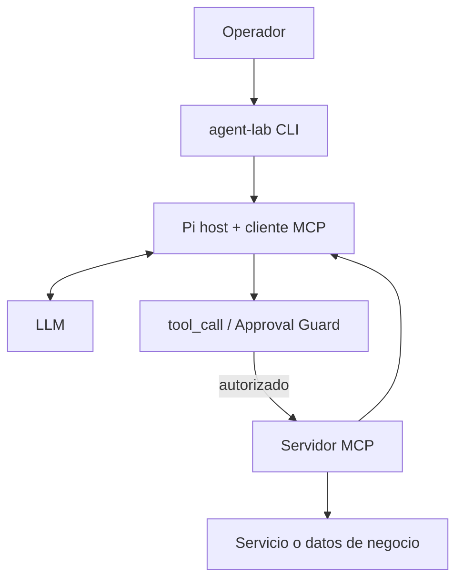

# Módulo 3 · Lección 1 — MCP e integración de herramientas externas

**Lección global:** 12/20
**Nombre:** Model Context Protocol (MCP), transportes, integración con Pi y controles de acceso
**Nivel:** Avanzado
**Complejidad:** Alta
**Tiempo de estudio:** 180–210 minutos
**Producto:** Agent Harness Lab v0.12.0 (sobre v0.11.0)
**Repositorio:** https://github.com/lucasjaviluna/agent-harness-lab

## 0. Antes de empezar

Esta entrega continúa el mismo proyecto. Al consultar GitHub el 17/11/2026, `main` informaba v0.10.0; no contenía aún la Lección 11. El patch parte del ZIP v0.11.0 del curso, no del checkout remoto. Incorporá primero la Lección 11 y revisá cualquier cambio local. El snapshot es una referencia, no reemplaza tus archivos propios (por ejemplo el lockfile o skills de tu equipo). No se hizo push. `src/runtime.ts`, el mecanismo `piCommand()` y los tests históricos quedan intactos. El CLI cambia únicamente su encabezado de versión; reutilizamos la configuración existente.

## 1. Objetivos

Al terminar vas a poder:

- Distinguir host, cliente, servidor, modelo y herramientas MCP.
- Leer una conversación JSON-RPC y diferenciar el protocolo de la lógica de negocio.
- Implementar una herramienta de historias de usuario ficticias y probarla sin un modelo.
- Conectar un servidor stdio usando MCP nativo de Pi.
- Configurar servidores locales/remotos, exposición, credenciales y permisos.
- Razonar sobre errores, compatibilidad de versiones, timeouts y fallos de seguridad.
- Aplicar un ejercicio completo y sus tests sin cambiar el runtime de Pi.

Prerequisitos: Lecciones 1–11, Node >=22.19 (mínimo de nuestro laboratorio), Pi instalado y autenticado para la práctica final. Para el servidor didáctico no necesitás Pi, acceso a Azure, cuenta de modelo ni dependencias externas. Los tests de integración con el CLI simulado requieren compilar previamente el proyecto.

## 2. Qué es MCP y qué no es

MCP es un protocolo para conectar aplicaciones de IA con servicios que exponen capacidades. Un servidor puede publicar herramientas (operaciones que el modelo puede pedir), recursos (datos identificados por URI) y prompts (plantillas que un cliente compatible puede ofrecer). El soporte de cada capacidad depende del host y la versión.

Una Custom Tool de la Lección 8 es una función registrada dentro del proceso Pi. Una MCP Tool vive en otro servicio/proceso que habla un contrato interoperable. Esto da independencia tecnológica: un mismo servidor puede ser implementado en Go, .NET, Python o TypeScript y servir a distintos hosts. MCP no es un LLM, un vector database, un sistema RAG ni un orquestador de workflows. Es una frontera de integración; un RAG podría exponerse mediante MCP, pero no se convierte en memoria por el solo hecho de usarlo.



Pi conserva el Agent Loop. El modelo solicita una herramienta, el host evalúa la política, el cliente MCP envía la petición y el servidor ejecuta su propia lógica. La respuesta regresa al modelo a través del host. El servidor no necesita tener credenciales de un LLM. El Approval Guard sólo controla operaciones que pasan por su pipeline; no contiene los procesos ni controla una llamada hecha por otro cliente.

| Mecanismo | Cuándo elegirlo |
|---|---|
| Skill | Instrucciones especializadas, no acceso automático a un sistema externo |
| Custom Tool | Funcionalidad local muy acoplada a Pi |
| MCP | Integraciones reutilizables entre hosts, servicios independientes |
| API REST directa | Comunicación convencional de aplicaciones o lógica interna de un servidor MCP |
| Workflow | Secuencia de tareas, aprobación y verificación; puede usar cualquiera de los anteriores |

## 3. Transportes y contrato

### stdio

Pi inicia un proceso hijo y usa stdin/stdout para mensajes. El proceso suele durar mientras el cliente lo necesita. No hay puerto que abrir; el ejecutable y sus argumentos son configuración de confianza. No escribas logs en stdout, porque contaminan el protocolo. Usá stderr. Evitá ejecutar shell y usá un binario conocido con argumentos separados. No requiere OAuth para hablar con el proceso local, pero el proceso puede acceder a sus propias variables de entorno y servicios.

### Streamable HTTP

Un servicio puede ser remoto, compartido por múltiples usuarios y escalado. El cliente comunica mediante un endpoint HTTP de MCP; según la negociación, el servidor puede responder con JSON o streaming SSE dentro del transporte. No es lo mismo que el antiguo transporte HTTP+SSE de MCP, que Pi no soporta según su documentación actual. En producción se necesitan HTTPS, autenticación, scopes mínimos, validación de identidad, autorización en el servidor, límites de recursos y observabilidad.

### JSON-RPC y versiones

En el ciclo clásico (por ejemplo revisión `2025-11-25`), el cliente envía `initialize`, recibe capacidades y versión, y manda `notifications/initialized`. Después puede usar `tools/list` y `tools/call`. Una notificación carece de ID y no recibe respuesta. Un request usa un ID para correlacionar su resultado/error. Revisiones posteriores del estándar (como `2026-07-28`) introducen descubrimiento y ciclo sin handshake con versión por petición; no supongas que todos los clientes soportan la misma revisión. El servidor didáctico implementa un subconjunto del ciclo clásico y negocia 2025-11-25, 2025-06-18 o 2025-03-26. **No** implementa el ciclo moderno, HTTP, cancelación remota, paginación general ni todas las garantías de un SDK. Para producción usá un SDK oficial y verificá interoperabilidad con la versión concreta de Pi. La alternativa SDK v2 está incluida como ejemplo separado.

### Ejemplo de mensajes clásicos

Request inicial (una línea en el transporte):

```json
{"jsonrpc":"2.0","id":1,"method":"initialize","params":{"protocolVersion":"2025-11-25","capabilities":{},"clientInfo":{"name":"lab","version":"1"}}}
```

Respuesta y notificación:

```json
{"jsonrpc":"2.0","id":1,"result":{"protocolVersion":"2025-11-25","capabilities":{"tools":{}},"serverInfo":{"name":"lab-stories","version":"0.12.0"}}}
{"jsonrpc":"2.0","method":"notifications/initialized"}
```

Descubrimiento y llamada:

```json
{"jsonrpc":"2.0","id":2,"method":"tools/list"}
{"jsonrpc":"2.0","id":3,"method":"tools/call","params":{"name":"get_story","arguments":{"id":"US-101"}}}
```

El listado anuncia nombre, descripción, schema de entrada y anotaciones. La llamada devuelve `content` (bloques tipados) y, si la revisión lo permite, `structuredContent`. Si el ID de negocio no existe, se devuelve `isError:true` dentro del resultado; en cambio un JSON malformado o un método no reconocido produce un error JSON-RPC. Que el transporte tenga éxito no garantiza que la operación de negocio haya tenido éxito. En el servidor didáctico, las validaciones del handler también se devuelven como errores de herramienta y los nombres inexistentes como error de parámetros JSON-RPC.

## 4. Nuestro servidor de historias ficticias

```text
examples/mcp/
├── stories.mjs                     # Núcleo puro y contrato de herramienta
├── server.mjs                      # Adaptador stdio clásico de aprendizaje
├── server-sdk.example.mjs          # Alternativa con SDK oficial v2, optativa
├── probe.mjs                       # Prueba de mensajes sin Pi
├── mcp.example.json                # Config Pi para copiar/combinar manualmente
└── tool-approvals.example.json     # Opt-in de permisos, no se aplica automáticamente
examples/config/harness.mcp.example.json
examples/prompts/mcp-lab.md
.pi/policies/approval-policy.mjs    # Extensión incremental, default unchanged
tests/mcp.test.mjs
solutions/modulo-03-leccion-01/
```

El objetivo es recuperar `US-101` o `US-102`. Los datos son literales sintéticos; no existe conexión a Azure DevOps ni acceso a disco arbitrario. Los criterios de aceptación son pequeños y acotados. Esta separación permite evolucionar el origen de datos sin modificar el protocolo.

El contrato de la herramienta tiene un ID obligatorio `US-NNN`, no admite campos extra y anuncia que no escribe. En `stories.mjs` se comprueba además el tipo, las propiedades presentes y el patrón antes de buscar. Esta es validación defensiva y no autorización. En un servidor real, además verificarías al usuario autenticado, su organización/proyecto y su permiso de lectura para esa historia.

```javascript
export function getStory(args) {
  // La versión completa comprueba tipos, propiedades y formato.
  if (!args || typeof args.id !== 'string' || !/^US-[0-9]{3}$/.test(args.id)) {
    return failure('ID inválido');
  }
  const value = stories[args.id];
  return value ? success(value) : failure('Historia no encontrada.');
}
```

En `server.mjs` se implementa el mínimo de mensajes del handshake clásico: `initialize`, notificación de inicialización, `ping`, `tools/list`, `tools/call`. No hay dependencias de npm. Se ejecuta con Node; las respuestas se escriben como JSONL. Un límite de longitud comprueba cada línea una vez leída (no limita la memoria previa del buffer de readline; no exponer a tráfico no confiable). Conexión local y datos fijos solamente. Para un sistema real, no copies este adaptador como infraestructura: reemplazalo por el SDK.

### SDK oficial (alternativa recomendada para un servicio real)

En un proyecto separado, instalá `@modelcontextprotocol/server` y `zod` (revisá que corresponda a v2 de la documentación). Copiá `stories.mjs` y `server-sdk.example.mjs` a ese directorio, ejecutá `npm init -y`, `npm install @modelcontextprotocol/server zod` y `node server-sdk.example.mjs`. El ejemplo utiliza módulos ESM `.mjs`. La API v2 utiliza `McpServer`, `registerTool` y `serveStdio`; v1 utiliza otros imports (`@modelcontextprotocol/sdk/server/mcp.js` y `StdioServerTransport`), no mezclar ambas versiones.

```javascript
import { McpServer } from '@modelcontextprotocol/server';
import { serveStdio } from '@modelcontextprotocol/server/stdio';
import * as z from 'zod/v4';
import { getStory } from './stories.mjs';

serveStdio(() => {
  const server = new McpServer({ name: 'lab-stories', version: '0.12.0' });
  server.registerTool('get_story', {
    description: 'Recupera una historia ficticia por ID',
    inputSchema: z.object({ id: z.string().regex(/^US-[0-9]{3}$/) }).strict()
  }, async args => getStory(args));
  return server;
});
```

El SDK administra el transporte, negociación y validación previa al handler. El archivo completo agrega las anotaciones del contrato. Este port es un ejemplo revisado contra la documentación vigente, **no ejecutado aquí** (sin paquetes SDK disponibles). Instalalo en un proyecto separado para no añadir dependencias al harness ni cambiar su lockfile. Verificá con MCP Inspector (`npx @modelcontextprotocol/inspector node server-sdk.example.mjs`, previa revisión de la dependencia) el catálogo y la llamada. Si querés conectar la variante a Pi, configurá su ruta absoluta y revisá la identidad del servidor antes de reutilizar la política.

## 5. Práctica A — probar el servidor sin tokens

Desde la raíz, ejecutá:

```bash
node examples/mcp/probe.mjs
npm install
npm test
npm run typecheck
```

El probe lanza Node como proceso independiente sin shell, envía una secuencia de mensajes clásicos y muestra las tres respuestas. No es un cliente general MCP; sólo una prueba de conversación determinista. El servidor espera stdin si lo ejecutás directamente. Resultado esperado de la tercera respuesta: `US-101`, título `Agregar perfil de ejecución`, estado `Ready` y sus criterios. Para practicar con errores cambiá el ID a uno inexistente en una copia de la prueba; observarás `isError` sin error de transporte.

## 6. Práctica B — conectar Pi de forma explícita

Pi administra la configuración y las conexiones. El archivo global es `~/.pi/agent/mcp.json` y el local `.pi/mcp.json`. Este último requiere confianza del proyecto; los valores de proyecto prevalecen según sus reglas de composición. La configuración por defecto de agent-lab sigue con `disableMcp:true` y `disableExtensions:true`.

1. Revisá `examples/mcp/server.mjs`, `stories.mjs` y los archivos de ejemplo. Trabajá en una copia de confianza y sin servidores o extensiones ajenos habilitados. Pi puede conectar todos los servidores habilitados aunque una lista de herramientas oculte sus tools; si tenés servidores de trabajo, usá un perfil/configuración de prueba aislado y verificá el catálogo primero. No entregues tokens de empresa al proceso local de ejemplo.
2. Si `.pi/mcp.json` no existe, copiá `examples/mcp/mcp.example.json` a esa ruta (en PowerShell usá `Copy-Item`, en Bash `cp`). Si existe, combiná manualmente sólo el servidor `lab_stories`, con un nombre que no colisione; nunca sobrescribas tu catálogo. El ejemplo no se activa solo por estar en `examples/`.

```json
{
  "mcpServers": {
    "lab_stories": {
      "command": "node",
      "args": ["examples/mcp/server.mjs"],
      "cwd": ".",
      "timeout": 10,
      "exposure": "direct",
      "description": "Historias ficticias de solo lectura para el laboratorio"
    }
  }
}
```

`node` debe estar en PATH. `cwd` se interpreta en relación con el directorio de la sesión. Usamos el ejecutable Node directamente para evitar `.cmd` y wrappers de shell en Windows. Los 10 segundos son por petición MCP, no el timeout global de 120 segundos del harness. No presupongas que el tiempo agotado significa que una mutación remota no ocurrió.

3. Revisá la política local `.pi/policies/tool-approvals.json`. Agregá sólo `"allowMcpTools": ["mcp__lab_stories__get_story"]`, combinando cualquier lista existente. No elimines `denyTools` ni `askTools`. Este opt-in permite el caso de laboratorio sin confirmación. No habilita otros servidores. Si la misma herramienta figura en deny/ask, estas decisiones ganan. Revertí la opción cuando termines.
4. Ejecutá `pi mcp list` desde la raíz para comprobar conexión y catálogo sin generar una respuesta del modelo. Debe aparecer `lab_stories` con `get_story`. Pi puede pedir confianza; revisá los archivos antes de autorizar. Si la versión instalada usa otro protocolo o requiere el ciclo moderno, probá la variante SDK oficial. No se comprobó Pi real en este entorno.
5. En modo interactivo, `pi` y `/mcp` permiten examinar conexiones, exposición, reconexión y autenticación. Reiniciá o ejecutá `/reload` tras cambios de configuración según corresponda. Asegurate de que el guard esté cargado para la práctica; al iniciar con `--extension .pi/extensions/approval-guard.ts` lo seleccionamos explícitamente. No uses `--no-extensions` en el ejemplo porque deshabilita también las integraciones nativas pertinentes.
6. Verificá argumentos sin iniciar Pi:

```bash
node dist/cli.js run-file examples/prompts/mcp-lab.md --config examples/config/harness.mcp.example.json --extension .pi/extensions/approval-guard.ts --mode json --view tools --dry-run
```

El resultado esperado no contiene `--no-mcp` ni `--no-extensions` y la lista `--tools` contiene exactamente `mcp__lab_stories__get_story`. Comprobá que tu proyecto esté ya marcado como confiable para esa ejecución, porque JSON/print no muestran un diálogo de trust.

7. Quitá `--dry-run` para una ejecución autenticada; observá los eventos. Si el modelo no llama a la herramienta o falla, no afirmes que se leyó la historia. Usá `--view summary` si querés texto final y resumen. JSONL completo puede incluir información sensible; no publiques logs reales. Los ejemplos de comandos están en una sola línea para que funcionen también en PowerShell.
8. Retirá la entrada `lab_stories` de `.pi/mcp.json` y el permiso añadido en `allowMcpTools` al terminar (conservá entradas ajenas). Mantené MCP deshabilitado en la configuración base. No subas configuraciones con tokens ni secretos.

## 7. Exposición, Codemode, Tool Search y alcance

Pi nombra las herramientas `mcp__<servidor>__<tool>` (normaliza caracteres y gestiona colisiones). Exposición y permiso son capas separadas. `direct` presenta la herramienta al modelo; `deferred` permite que se descubra; `codemode` es el modo indirecto predeterminado; `hidden` la mantiene inaccesible al modelo. En esta lección elegimos `direct` para observar una sola operación sin complejidad extra. Con muchos servidores, `codemode`/`deferred` pueden ser preferibles.

Para experimentar, cambiá la propiedad `exposure` de `lab_stories` a `codemode` en tu copia del archivo local, conservá la lista de nombres explícitos y agregá `codemode` a `pi.tools` de una copia del config del lab. Solicitá que descubra `get_story`, inspeccione su contrato y lo invoque. En Pi, habilitar `codemode` y no dar patrones MCP explícitos NO impide por sí solo descubrir otras herramientas MCP. Mantené el nombre exacto y un guard activo, además de servidores de confianza aislados. Para `deferred` agregá `tool_search` a la lista en lugar de codemode; revisá la exposición efectiva con `/mcp`. Si una extensión propia reemplaza `codemode`/`tool_search`/`/mcp` no supongas que conserva las mismas garantías.

No hay allowlist de servidor en el core del harness: lo administra Pi; `--tools` por sí sola tiene semántica especial con MCP. El selector del laboratorio sólo acepta nombres exactos. Las llamadas directas y anidadas de MCP pasan por `tool_call`/`tool_result` según la documentación actual. Un permiso para el dispatcher `codemode` no debe implicar automáticamente permiso para cada tool hija. Esto debe comprobarse en una sesión con la versión instalada de Pi antes de usarlo fuera del laboratorio.

## 8. Políticas: no confiar en nombres ni anotaciones por sí solos

Antes del cambio, nuestro guard denegaba herramientas desconocidas, incluyendo MCP. Mantuvimos esa regla. Se agrega un campo opcional a la política existente, `allowMcpTools`, que sólo acepta nombres MCP exactos y no admite comodines ni herramientas genéricas. Orden relevante: deny primero; reglas fijas internas; ask; allow exacto revisado; allow de herramientas internas; finalmente deny. El campo omitido equivale a conjunto vacío. Agregar un nombre es una decisión explícita del operador, no una inferencia del LLM. El ejemplo incluye el ID de la herramienta de historias ficticias; no alteramos la política base del repositorio.

```json
{"version":1,"bash":"deny","denyTools":[],"askTools":[],"allowMcpTools":["mcp__lab_stories__get_story"]}
```

Es importante: el nombre y las anotaciones MCP como `readOnlyHint` son metadatos que puede declarar un servidor malicioso. Una herramienta de otro origen puede adoptar el mismo nombre. El permiso por nombre de este lab **no verifica identidad del servidor ni contenido ejecutable**. Revisá la ruta ejecutada, versión, configuración y credenciales; no permitas modificaciones al catálogo sin revisión. Para producción, necesitamos identidad y procedencia verificadas, credenciales con scopes limitados, autorización en el servicio, límites de red/FS, aprobación de mutaciones y separación de procesos. El guard no reemplaza un sandbox ni controla efectos al conectar un servidor. Los resultados también son datos no confiables y pueden contener prompt injection. No los trates como órdenes de sistema.

En print/JSON, una regla `ask` se deniega sin UI. Si querés experimentar con confirmación, eliminá el nombre de `allowMcpTools` y agregalo a `askTools`, usá Pi interactivo con el guard explícito y rechazá/aceptá una llamada. No se debe aprobar por defecto ni convertir una acción de escritura real en lectura mediante un nombre.

## 9. Servidores externos y credenciales

En un futuro MCP de Azure DevOps, el servidor ofrecería `get_work_item`, `list_acceptance_criteria` y, eventualmente, operaciones de cambio controladas. El handler consultaría una API de Azure con permisos de sólo lectura. El modelo jamás debe recibir el token de Azure. Separar búsqueda/lectura y modificación; usar IDs validados, autorización por proyecto, timeouts, límites de páginas y auditoría. Si se agrega una mutación, considerar idempotencia y verificación posterior; no repetir ciegamente tras errores de red.

Ejemplo conceptual de servidor remoto (URL ilustrativa, no endpoint real):

```json
{
  "mcpServers": {
    "internal_docs": {
      "url": "https://example.com/mcp",
      "headers": { "Authorization": "Bearer ${DOCS_TOKEN}" },
      "exposure": "deferred",
      "timeout": 30
    }
  }
}
```

Pi puede resolver valores de variables de entorno. No pongas el token literal en archivos del repositorio, logs ni instrucciones. Para proveedores que admiten OAuth, configurá la URL y seguí el login de Pi (`/mcp`, `pi mcp login <server>`); tokens y scopes se gestionan según proveedor. La autenticación del LLM y la de un MCP remoto son independientes. No habilites mecanismos de sustitución que ejecuten comandos de una configuración no confiable. Verificá servidor HTTPS, identidad, scopes y permisos del usuario. Un servidor local puede heredar el entorno o valores configurados: minimizá el entorno y aislá credenciales. El servidor puede ejecutar código al iniciar, antes de que el modelo invoque nada.

## 10. Tests y troubleshooting

Pruebas nuevas de `tests/mcp.test.mjs`:

- Handshake y discovery, correlación por IDs y notificaciones sin respuesta.
- Rechazo antes de inicialización y negociación de revisión clásica.
- Errores JSON-RPC, parámetros inválidos y resultado de dominio `isError`.
- Política por defecto, opt-in exacto, precedencia deny/ask y rechazo de comodines.
- Dry-run real del CLI, sin Pi: defaults intactos y lista de la herramienta específica.

| Síntoma | Revisar |
|---|---|
| MCP no aparece | config local/trust, `--no-mcp`, extensiones nativas, PATH, `pi mcp list` |
| Servidor desconectado | stderr, ruta del ejecutable, cwd, protocolo negociado, timeout |
| Tool no se declara | exposición y selección de herramientas (`--tools`) |
| Tool se descubre pero bloquea | Approval Guard, política de permisos, interfaz disponible |
| Error de protocolo | stdout sólo JSON-RPC, no banners, IDs y revisión correctos |
| Servidor remoto 401/403 | autenticación MCP, OAuth/scopes y permisos del recurso |
| Modelo inventa historia | respuesta de tool, eventos, prompt y verificación independiente |

Pruebas realizadas aquí: Node 22.16 (inferior al mínimo declarado 22.19), compilación con tsc 5.8.3 y tipos Node disponibles; 151 tests pasan, 1 Windows omitido; con ejercicio integrado 154 pasan, 1 Windows omitido. El servidor stdio se ejecuta de verdad en proceso separado; Pi real, SDK optativo, HTTP, OAuth y Windows no se ejecutaron. No se certifica compatibilidad total con Pi actual ni seguridad de producción. No hubo conexión a Azure ni consumo de modelo. La integración se verifica localmente después de instalar la versión requerida de Node y Pi.

## 11. Ejercicio US-LAB-012 — Listar historias por estado

Implementá `list_stories({state})` en el servidor didáctico. Sólo acepta `Ready` o `Active`, y devuelve `structuredContent:{stories:[...]}` y un bloque de texto. Cada elemento expone únicamente ID, título y estado. La lista no modifica las historias ni lee archivos. Agregá el schema al catálogo y el dispatch al método `tools/call`.

Criterios de aceptación:

1. `tools/list` devuelve `get_story` y `list_stories` sin eliminar la anterior.
2. `list_stories` con Ready retorna US-101; Active retorna US-102.
3. Argumentos inválidos o adicionales generan error de herramienta.
4. El servidor no usa shell, disco arbitrario, red ni secretos.
5. La nueva herramienta permanece denegada hasta que sea revisada y permitida de forma explícita. No se admiten comodines.
6. La suite anterior sigue pasando y las nuevas pruebas cubren discovery y llamada real por stdio.

Pistas: reutilizá `success` y `failure`, `Object.values(stories).filter(...)`, y proyectá los campos. En el servidor agregá `listTool` a `tools/list` y hacé dispatch por nombre. No agregues un motor genérico de routing antes de necesitarlo. Si portás la solución al SDK oficial, `registerTool` debe usar su correspondiente schema enum.

La solución completa está en `solutions/modulo-03-leccion-01/`. Se puede examinar o ejecutar sin copiar nada:

```bash
node --test solutions/modulo-03-leccion-01/tests/list-stories.test.mjs
```

Leé su README para aplicar sólo los archivos del ejercicio. La configuración de exposición y permiso adicional es manual; no se modifica el proyecto base.

## 12. Repaso y siguientes pasos

1. ¿Por qué MCP no sustituye al Agent Loop? Porque define el intercambio con un servidor; el host decide cómo conversar con el modelo y ejecutar las herramientas.
2. ¿Una herramienta declarada de lectura es segura? No: anotaciones/nombres no autentican al servidor, y lectura también puede divulgar datos.
3. ¿Por qué stdout no debe contener logs? Interfiere con la delimitación y parseo del transporte stdio.
4. ¿Qué diferencia existe entre error JSON-RPC e `isError`? Fallo de protocolo/operación frente a resultado de herramienta fallido; ambos requieren tratamiento.
5. ¿Por qué no se usa un token de Azure en el prompt? Las credenciales pertenecen a la integración con el sistema, no al modelo, y deben limitarse por identidad y permisos.
6. ¿Qué ocurre si no hay UI para aprobar? El guard bloquea `ask`; no aprueba silenciosamente.
7. ¿Qué elegirías para un servicio corporativo compartido? SDK oficial, servicio HTTP protegido, scopes, autorización, auditoría; Pi nativo como consumidor y no como proxy general.

Terminado este módulo parcial: 12/20 (60%). Quedan 8 lecciones. Siguiente: Módulo 3 · Lección 2 (global 13), Pi SDK — integración programática, AgentSession y eventos. Compararemos el SDK con el adaptador de CLI, estudiaremos su carga explícita de recursos/extensiones MCP en vez de dar por supuesto que se cargan automáticamente, y evitaremos reescribir un runtime que ya funciona.

## 13. Recursos oficiales consultados (17/11/2026)

- Pi — MCP Servers: https://docs.pi.dev/latest/mcp
- Pi — documentación: https://docs.pi.dev/latest/
- Pi — código fuente: https://github.com/earendil-works/pi
- MCP — documentación: https://modelcontextprotocol.io/
- MCP TypeScript SDK v2: https://ts.sdk.modelcontextprotocol.io/v2/
- Guía SDK v2 server: https://ts.sdk.modelcontextprotocol.io/v2/get-started/first-server
- SDK stdio: https://ts.sdk.modelcontextprotocol.io/v2/serving/stdio
- Información de transición a lifecycle moderno: https://go.sdk.modelcontextprotocol.io/protocol/
- MCP Inspector: https://github.com/modelcontextprotocol/inspector

Recordá: para producción se debe emplear una implementación completa del protocolo y validar la versión instalada del cliente y del SDK. Esta lección construye una integración de aprendizaje con fixtures explícitos, no un servidor empresarial desplegado.
