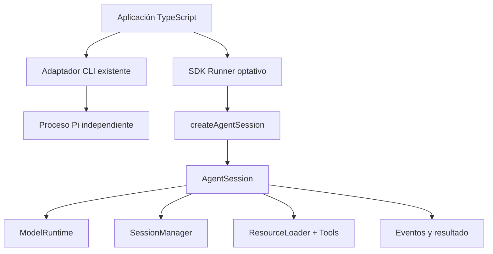

# Módulo 3 · Lección 2 (global 13) — Pi SDK, AgentSession y ejecución programática

**Nivel:** avanzado · **Complejidad:** alta · **Duración sugerida:** 180–210 minutos
**Proyecto:** Agent Harness Lab v0.12.0 → v0.13.0
**Repositorio:** https://github.com/lucasjaviluna/agent-harness-lab
**Referencia:** Pi 1.5.2; documentación SDK consultada el 17 de noviembre de 2026.

## 1. Objetivo y punto de partida

Hasta la lección 12 nuestro CLI ha delegado el Agent Loop, las sesiones, las extensiones y MCP a un proceso Pi. Esta lección agrega un segundo camino: ejecutar Pi como biblioteca en un proceso Node.js. No modifica `src/cli.ts`, `src/runtime.ts`, `piCommand()`, el approval guard ni los tests de Windows. No se duplica el ciclo del agente.

Al terminar podrás explicar la diferencia entre SDK/CLI/RPC, crear y cerrar una sesión, reutilizar su historial para solicitudes sucesivas, seleccionar modelos, observar eventos, cancelar cooperativamente, registrar herramientas propias, configurar recursos y reconocer qué piezas adicionales exige MCP.

**Base comprobada:** GitHub main mostraba v0.11.0 (árbol `9e6b94c507516546089cfe43e8500db99c98dcda`); la implementación parte del snapshot v0.12.0 entregado en la lección anterior, no de una copia exacta de main. Primero aplicar la lección 12. El snapshot no pretende reemplazar tus archivos locales/lockfiles. La compatibilidad exacta con tu checkout debe verificarse con `git apply --check`.

## 2. Tres límites de integración

| Propiedad | CLI print/JSON | SDK | RPC |
|---|---|---|---|
| Frontera | stdout/exit code | llamadas TypeScript | mensajes entre procesos |
| Estado vivo | una invocación | sesión reutilizable | proceso persistente |
| Entrada durante ejecución | no desde nuestro adaptador actual | steer/followUp | comandos RPC |
| Eventos | JSONL si se solicita | objetos tipados | JSONL |
| Fallos | proceso separado | mismo proceso host | proceso separado |
| Dependencias | binario Pi | paquete npm Pi | binario Pi |

Un proceso separado aísla parte de los fallos, no es un sandbox. SDK facilita interacción con eventos y estado, no hace al modelo más inteligente o barato. Si un servidor web comparte proceso con una extensión, esa extensión tiene los permisos del proceso. Para workloads no confiables, usar mecanismos de aislamiento externos.



No generalizamos los dos caminos en un contrato común todavía. En la siguiente lección implementaremos comunicación RPC y después compararemos necesidades de workflows reales. No hay motivo para crear una fábrica de adaptadores, contenedores DI o un orquestador antes de tener esos casos.

## 3. Instalación reproducible y configuración

Desde la raíz, con Node >= 22.19:

```sh
npm install
npm test
npm run typecheck
npm install --prefix examples/sdk --ignore-scripts
npm run sdk:typecheck
```

`examples/sdk/package.json` fija Pi 1.5.2 y TypeBox 1.3.27. Es un paquete independiente, no una dependencia del CLI de las lecciones anteriores. `npm install --prefix` genera un lockfile propio para el SDK si no existe. Guardarlo en Git después de revisarlo. Los scripts del proyecto raíz llaman al runtime TypeScript de Node (`--experimental-strip-types`), sin agregar otro transpilador. El núcleo sí se compila junto con el proyecto mediante tsc. La comprobación `sdk:typecheck` comprueba los ejemplos contra los tipos reales del SDK una vez instalado.

No hace falta reinstalar el CLI global para usar el SDK local; sí hace falta configurar un proveedor compatible. Se puede utilizar una autenticación previamente configurada en Pi, siempre que la versión y directorio de agente coincidan. Verificar con `pi`, `/login` y `/model`. No guardar API keys en JSON del laboratorio ni pasar secretos por línea de comandos. En una aplicación multiusuario usar credenciales separadas, no compartir automáticamente las del operador. El uso de suscripción/API depende del proveedor y sus condiciones.

**Importante:** en el SDK Runner usamos `SettingsManager.inMemory()`, por lo que no importamos los settings persistentes del CLI (ni sus perfiles). Si no se indica `--model`, el SDK resuelve el modelo disponible con su configuración en memoria y su catálogo/credenciales. Puede ser distinto de tu selección habitual en el CLI. Para una prueba reproducible indicá `--model provider/id` explícito.

## 4. La sesión mínima

```ts
import { createAgentSession, SessionManager } from '@earendil-works/pi-coding-agent';

const { session } = await createAgentSession({
  sessionManager: SessionManager.inMemory(process.cwd()),
  tools: [],
});
try {
  await session.prompt('Explica el concepto de un Agent Loop.');
  console.log(session.getLastAssistantText());
} finally {
  session.dispose();
}
```

El fragmento enseña la API mínima, no la configuración defensiva completa. Aunque las herramientas estén vacías, la factory por defecto descubre recursos del usuario y proyecto; no ejecutarlo en un workspace no confiable. Nuestro runner incorpora un loader explícito en la sección 7. Las instrucciones son texto, no garantías de seguridad.

### 4.1 Responsabilidades

- `createAgentSession`: integra servicios y devuelve `session`, diagnósticos de extensiones y eventualmente un aviso de modelo de respaldo.
- `AgentSession`: contiene conversación, modelo, herramientas activas, colas de mensajes, compactación, runtime de extensiones y suscripciones.
- `SessionManager`: almacén de entradas e historial. Por defecto la sesión es persistente; `inMemory(cwd)` evita los archivos de sesión. No significa que el proveedor no procese/retenga el contenido ni que ningún otro componente escriba disco.
- `ModelRuntime`: catálogo, selección y acceso a proveedores. No construyas clientes HTTP de LLM paralelos.
- `SettingsManager`: configuración; `inMemory()` permite controlar ajustes sin copiar settings de cada operador.
- `DefaultResourceLoader`: descubrimiento de skills, templates, instrucciones, extensiones y temas. Usar overrides con cuidado; no ejecutar paquetes de terceros no revisados.

### 4.2 Dos prompts, una misma sesión

```ts
try {
  await session.prompt('Mi ejemplo de proyecto se llama Nebula.');
  await session.prompt('¿Cómo se llama el proyecto que mencioné?');
  console.log(session.getLastAssistantText());
} finally { session.dispose(); }
```

El segundo prompt recibe el contexto conversacional de la sesión. No es RAG y no hace falta inventar un vector store para recordarlo. Si creamos otra `AgentSession` en memoria, comienza una conversación independiente. Para restaurar una persistente, usar `SessionManager` y la API de sesiones; no asignar `agent.state.messages` esperando reconstruir el árbol de historial.

## 5. Eventos y finalización real

```ts
const unsubscribe = session.subscribe(event => {
  if (event.type === 'message_update' && event.assistantMessageEvent.type === 'text_delta') {
    process.stderr.write(event.assistantMessageEvent.delta);
  }
});
try { await session.prompt('Resume el concepto de un SDK.'); }
finally { unsubscribe(); session.dispose(); }
```

| Evento | Interpretación |
|---|---|
| `agent_start` | inicia un run de bajo nivel |
| `turn_start`/`turn_end` | delimitan un turno interno del agente |
| `message_update` | delta de texto/pensamiento u otra actualización; no es mensaje definitivo |
| `message_end` | mensaje completo, incluye stopReason del assistant |
| `tool_execution_start` | comenzó una ejecución de herramienta (puede ser bloqueada luego) |
| `tool_execution_end` | resultado de la herramienta; isError puede ser true |
| `agent_end` | final de un run de bajo nivel, no necesariamente de la solicitud |
| `agent_settled` | PI terminó el trabajo automático asociado; incluye aborted |

Una secuencia posible es `agent_start → turn_start → message_update … → message_end (toolUse) → tool_execution_start/end → turn_end → turn_start → message_end (stop) → turn_end → agent_end → agent_settled`. Es ilustrativa; los eventos pueden intercalarse por llamadas paralelas, recuperación y compactación. El consumidor no debe asumir un número fijo.

Un prompt puede completar su Promise y aun haber terminado con error de proveedor o aborto. Por ello el núcleo exige que la última respuesta del assistant observada durante ese prompt tenga `stopReason: stop` y que se observe `agent_settled` sin aborto. Esta política deliberadamente estricta trata `length` y finalizaciones sin evento final como incompletas. Una herramienta con error recuperable no implica que el prompt completo falle si el modelo termina normalmente; lo contabilizamos.

Nuestra vista no emite eventos crudos ni thinking. Cuenta intentos de herramienta, errores y eventos por prompt. No son tokens ni métricas de facturación. `getLastAssistantText()` devuelve texto final o undefined, normalizado a null. Si el SDK cambia los eventos, ajustar el consumidor contra su versión y tests.

## 6. Cancelación, colas y liberación de recursos

La sesión mantiene un trabajo activo. No enviar dos `prompt()` concurrentes sin una política explícita. `steer()` permite introducir una indicación mientras la sesión trabaja, `followUp()` encola trabajo para después del run; el SDK también acepta modos de streaming adecuados en `prompt()`. Estudiar sus firmas antes de usarlos. Nuestro primer runner es secuencial; no implementa colas paralelas ni subagentes.

`abort()` solicita cancelar y espera que la sesión quede libre. `waitForIdle()` espera sin cancelar. El timer de nuestra aplicación llama `abort()` cooperativamente y espera la finalización antes de liberar la sesión. El timeout es por prompt, no por inicialización del SDK; no es un límite estricto de reloj si el proveedor o una herramienta no coopera. Un proceso bloqueado puede requerir terminarlo externamente. No usamos `Promise.race` para abandonar el trabajo activo dejando recursos sin liberar. Para límites de ejecución más fuertes utilizaremos un proceso supervisor y aislamiento en módulos posteriores.

El `finally` interno cancela el timer, espera la cancelación solicitada y elimina el listener. El `finally` exterior ejecuta `dispose()`, incluso si se rechaza un prompt. Si la factory falla antes de entregar la sesión, la factory debe liberar cualquier recurso que haya adquirido. En el puente esto se aplica a errores de `bindExtensions` o selección de herramientas.

## 7. Qué implementamos en v0.13.0

```text
src/sdk-runner.ts                         # contrato mínimo y runner probado
examples/sdk/package.json                # dependencia Pi separada y fija
examples/sdk/tsconfig.json               # typecheck adicional con SDK real
examples/sdk/run.ts                      # puente real de TypeScript
examples/sdk/custom-tool.example.ts      # herramienta explícita
 tests/sdk-runner.test.mjs                # suite sin proveedor
solutions/modulo-03-leccion-02/           # ejercicio resuelto separado
```

### 7.1 Configuración del host

```ts
const settingsManager = SettingsManager.inMemory();
const resourceLoader = new DefaultResourceLoader({
  cwd, agentDir: getAgentDir(), settingsManager,
  noExtensions: true, noSkills: true, noPromptTemplates: true,
  noThemes: true, noContextFiles: true,
  disabledBuiltinExtensions: ['mcp', 'codemode', 'tool_search'],
  systemPromptOverride: () => 'Eres un asistente de laboratorio.',
  appendSystemPromptOverride: () => [],
});
await resourceLoader.reload();
```

La configuración normal del CLI sigue intacta. Este laboratorio controla el contexto mediante recursos explícitos. No se cargan extensiones descubiertas, skills, templates ni archivos AGENTS por defecto; se reemplaza el system prompt de descubrimiento. Usamos el directorio de agente para localizar el modelo/credenciales y la configuración relevante del SDK; no prometer ausencia absoluta de efectos de filesystem, red o persistencia de catálogos. Las opciones de loader y tool allowlist reducen superficie de ataque, no son un sandbox. `--read-only` permite leer archivos accesibles al proceso (posiblemente fuera de cwd); usar un repositorio de prueba sin secretos, nunca un workspace corporativo sensible para pruebas de primer contacto.

### 7.2 Selección de modelo y herramientas

```ts
const modelRuntime = await ModelRuntime.create();
const model = modelRuntime.getModel('openai', 'gpt-4o'); // ID ilustrativo
if (!model) throw new Error('Modelo no encontrado');
const { session } = await createAgentSession({
  cwd, modelRuntime, model, thinkingLevel: 'low',
  settingsManager, resourceLoader,
  sessionManager: SessionManager.inMemory(cwd),
  tools: [],
});
```

El ejemplo real permite omitir modelo o elegir `provider/id`, sin glob ni alias ambiguo. `getModel` no garantiza credenciales válidas. El SDK ajusta thinking a capacidades del modelo; en esta lección no pretendemos medir costos. Antes de ejecutar comprueba catálogo con `agent-lab models` o `pi --list-models`. El CLI y SDK podrían usar configuraciones/versiones distintas: comprobar que ambos pueden acceder al ID elegido.

`tools: []` significa no habilitar herramientas. `--read-only` habilita los nombres exactos `read`, `grep`, `find`, `ls`. No depende de la configuración CLI ni activa el guard de la lección 9. Este comportamiento está separado explícitamente para no dar la impresión de que el guard protege la nueva vía. En próximas lecciones, antes de permitir escritura, shell o MCP, será necesario definir políticas compartidas y validar que se instalaron en cada runtime.

### 7.3 Contrato mínimo y ejecución

```ts
export interface SdkSession {
  subscribe(listener: (event: unknown) => void): () => void;
  prompt(text: string): Promise<void>;
  abort(): Promise<void>;
  getLastAssistantText(): string | undefined;
  dispose(): void;
}
```

`runSdkSession(create, options, onDelta)` recibe una factory que devuelve una sesión. Esta interfaz pequeña no sustituye el SDK; representa sólo las operaciones utilizadas por nuestro host y nos permite inyectar una sesión simulada. Se crea una instancia, se registra un listener distinto por cada prompt, se comprueba finalización, se recopilan métricas y se libera. Ver implementación completa en `src/sdk-runner.ts` y el adaptador real en `examples/sdk/run.ts`. No es una capa genérica de orquestación.

La salida estándar del runner es un resumen JSON si la ejecución completa. Con `--stream`, deltas de texto a stderr; un error puede ocurrir después de emitir texto parcial, y la salida de dependencias externas no queda bajo control absoluto del host. No guardar prompts o transcripciones automáticamente. El resumen contiene texto generado, potencialmente sensible: no registrarlo en producción sin política de protección de datos.

## 8. Laboratorio paso a paso

Desde la raíz del repositorio, después de instalar dependencias de ambas carpetas, probar primero un prompt sin herramientas (usa un proveedor y consume tokens):

```sh
npm run sdk:run -- "Explica qué es una sesión agéntica en dos frases"
npm run sdk:run -- "El proyecto ficticio se llama Nebula" "¿Cómo se llama el proyecto?"
npm run sdk:run -- --stream "Explica qué es un Agent Loop"
```

Cada argumento posicional es un prompt completo. Usar comillas. Los flags pueden preceder los prompts; para pasar texto que empieza con `-` usar el separador `--` a nivel de script. El `--` de npm separa argumentos de npm; no se pasa al runner. Los comandos mostrados funcionan en una línea en PowerShell.

Ejemplo de salida (valores ilustrativos, no una sesión real medida):

```json
{
  "turns": [
    { "text": "Entendido, Nebula.", "events": 15, "tools": 0, "toolErrors": 0 },
    { "text": "Nebula.", "events": 11, "tools": 0, "toolErrors": 0 }
  ]
}
```

Luego usar herramientas de consulta sólo contra el laboratorio de ejemplo sin secretos:

```sh
npm run sdk:run -- --read-only "Enumera los archivos de src sin modificarlos"
npm run sdk:run -- --thinking low --timeout-ms 60000 "Resume el flujo de ejecución de Pi"
```

Si querés seleccionar un modelo explícito, sustituí `openai/gpt-4o` por un ID vigente de tu catálogo:

```sh
npm run sdk:run -- --model openai/gpt-4o --thinking low "Describe el patrón Adapter"
```

Comparar con `node dist/cli.js run "Describe el patrón Adapter" --mode json`: el anterior comunica por JSONL y termina el proceso; el SDK permite mantener más prompts y consultar sesión directamente. No comparar rendimiento usando modelos distintos o cargas distintas.

## 9. Custom Tools y extensiones inline

En `examples/sdk/custom-tool.example.ts` se usa `defineTool` y TypeBox para registrar `lab_sdk_status`, una herramienta de resultado fijo sin filesystem ni red propios. `createAgentSession({ customTools: [labStatus], tools: ['lab_sdk_status'], ... })` registra y selecciona explícitamente el tool. Práctica: `npm run sdk:tool`. Requiere instalación del SDK y proveedor autenticado. El modelo podría no llamar al tool; observar `turns[0].tools` y no asumir ejecución por el texto de respuesta.

Ejemplo conceptual para registrar eventos sin archivo de extensión:

```ts
const loader = new DefaultResourceLoader({
  cwd, agentDir,
  extensionFactories: [pi => {
    pi.on('tool_call', event => {
      if (event.toolName === 'bash') return { block: true, reason: 'Shell deshabilitado' };
    });
  }],
});
await loader.reload();
const { session } = await createAgentSession({ resourceLoader: loader, tools: ['read'] });
try {
  await session.bindExtensions({});
  await session.prompt('Resume un archivo de ejemplo');
} finally { session.dispose(); }
```

El ejemplo muestra la extensión inline, no una política completa. Con ese loader por defecto también se descubren otros recursos/extension factories. No ejecutarlo en un workspace no confiable. Para integrar nuestro guard, cargar explícitamente la extensión adecuada, revisar diagnósticos, asegurar que se inicializó y validar el funcionamiento real con herramientas bloqueadas. No permitir otras extensiones capaces de alterar la política. `bindExtensions({})` inicializa el ciclo de extensiones y dispara `session_start`; usar UI adecuada si el host dispone de ella, nunca simular una aprobación con true.

## 10. MCP en el SDK: diferencias con el CLI

La lección anterior empleó el cliente MCP nativo del CLI. El SDK no carga automáticamente las extensiones integradas Codemode, Tool Search y MCP. Se deben suministrar factories. El siguiente patrón es una referencia de wiring, **no** está activo en nuestro runner ni se ejecutó en este entorno:

```ts
import {
  createAgentSession, createCodemodeExtension, createToolSearchExtension,
  createMcpExtension, DefaultResourceLoader, getAgentDir,
  SettingsManager, SessionManager,
} from '@earendil-works/pi-coding-agent';

const cwd = process.cwd();
const settingsManager = SettingsManager.inMemory({
  defaultTools: ['read', 'codemode', 'tool_search'],
});
const resourceLoader = new DefaultResourceLoader({
  cwd, agentDir: getAgentDir(), settingsManager,
  extensionFactories: [
    createCodemodeExtension({ mode: 'on' }),
    createToolSearchExtension(),
    createMcpExtension(),
  ],
});
await resourceLoader.reload();
const { session } = await createAgentSession({
  cwd, settingsManager, resourceLoader,
  sessionManager: SessionManager.inMemory(cwd),
});
try {
  await session.bindExtensions({});
  console.log(session.getActiveToolNames());
  // Después de revisar el guard y las herramientas, enviar un prompt autorizado.
} finally { session.dispose(); }
```

`createMcpExtension()` puede leer configuración del agente y proyecto confiable, iniciar procesos o conectarse a servicios al inicializar. **No ejecutar este snippet con configuración de servidores desconocida.** En una integración real suministrar la configuración revisada, limitar herramientas, instalar/verificar el guard, evitar permisos amplios y usar el servidor ficticio de la lección 12. En el SDK las herramientas MCP directas pueden estar conectándose en segundo plano, y las exposiciones deferred/codemode tienen sus propias reglas de activación. La opción `tools` puede cambiar la visibilidad de MCP; el ejemplo oficial usa `defaultTools` para habilitar los dos mecanismos y no filtrar accidentalmente el catálogo.

Para probar el protocolo con el server local sin LLM, sigue disponible `node examples/mcp/probe.mjs`. Para el uso de producción no clonamos el cliente MCP y no reescribimos JSON-RPC. En esta versión el bridge SDK básico deshabilita MCP deliberadamente: paridad CLI/SDK se evaluará más adelante.

## 11. Tests y troubleshooting

```sh
npm test
npm run typecheck
# Tras instalar Pi SDK en examples/sdk:
npm run sdk:typecheck
```

La suite nueva utiliza `fake()` con `subscribe`, `prompt`, `abort`, `getLastAssistantText` y `dispose`: prueba opciones, contrato secuencial, filtrado de deltas, ausencia de streaming por defecto, errores, ejecuciones sin agente asentado, abortos, timeout cooperativo y limpieza. No se burla el LLM para simular calidad de respuestas: no se usa LLM. Los tests anteriores comprueban regresión del CLI y siguen intactos.

| Problema | Diagnóstico |
|---|---|
| ERR_MODULE_NOT_FOUND en SDK | ejecutar `npm install --prefix examples/sdk --ignore-scripts` |
| Error de tipos en sdk:typecheck | confirmar versión exacta, Node y cambios de SDK |
| Modelo no encontrado | comprobar ID exacto provider/id, catálogo/credenciales |
| Error de autenticación | verificar Pi y directorio de agente, variables de entorno; no pegar claves en el chat |
| SDK_INCOMPLETE / ejecución fallida | comprobar motivo de parada, eventos, proveedor, límites; runner oculta payloads internos |
| Tiempo máximo excedido / código 124 | la cancelación se solicitó; reducir tarea, comprobar proveedor y herramientas |
| Tool no llamado | revisar lista activa y evidencia de eventos; el modelo puede elegir no usarlo |
| Error de configuración MCP | el SDK básico no lo carga; consultar ejemplo oficial y validar server mediante probe |

Para el laboratorio utilizamos Node 22.16 localmente, inferior al mínimo de Pi 22.19; sólo se probaron el núcleo y los tests previos. La instalación del SDK falló por resolución DNS del registro npm (EAI_AGAIN), por lo que la compilación específica `sdk:typecheck`, la carga real de SDK, la sesión autenticada y Windows requieren verificación en tu entorno. No confundir `npm run typecheck` correcto con `sdk:typecheck` correcto. El runner no registra detalles de error del proveedor para evitar exposición accidental, aunque eso limita el diagnóstico inicial; no añadir dumps de credenciales o prompts para debug.

## 12. Ejercicio práctico US-LAB-013 — Métricas de ejecución

Añadir `internalTurns` y `elapsedMs` a cada resumen por prompt sin cambiar el comportamiento del runner.

Historia: como operador quiero saber cuántos turnos internos necesitó cada solicitud y cuánto tardó, para comparar estrategias sin confundir el número de prompts con el número de turnos internos del LLM.

Criterios:
1. Contar eventos `turn_end` por prompt, no `agent_end` ni cantidad de mensajes.
2. Medir duración monotónica con `performance.now()` y devolver un entero no negativo.
3. Reiniciar contadores al comenzar el siguiente prompt y mantener el mismo objeto sesión.
4. No registrar tool inputs, thinking, prompts o secretos adicionales.
5. Mantener propagación de errores, timeout y cleanup.
6. Añadir mínimo dos tests sin Pi: secuencia de eventos diferente por prompt y duración no negativa.

Pistas: extender `SdkTurnResult`, tomar la hora inmediatamente antes de registrar el listener, incrementar sólo con `turn_end`, calcular la diferencia antes de guardar el resultado. No usar Date.now para medir intervalos sujetos a cambios de reloj del sistema.

Solución completa en `solutions/modulo-03-leccion-02/`. Comparar los archivos, aplicar los cambios a `src/sdk-runner.ts` y copiar `sdk-metrics.test.mjs` a `tests/`. Correr la suite. La solución incluye los dos tests solicitados.

## 13. Preguntas de repaso con respuestas

- ¿Por qué no reemplazar el CLI? Porque el CLI es una vía independiente de lenguaje y proceso, ya probada; el SDK resuelve otro caso de uso: control programático directo.
- ¿Qué pasa si se llama `prompt` dos veces simultáneamente? No se debe asumir que el SDK encola automáticamente; especificar steering/follow-up o esperar. Nuestro runner espera.
- ¿Por qué no usar agent_end para marcar éxito? Porque puede haber recuperación o trabajo pendiente; necesitamos settlement y el motivo de parada final.
- ¿Es seguro `SessionManager.inMemory()`? Evita persistencia de la sesión, no evita enviar información al modelo o que otros recursos escriban disco.
- ¿Por qué separar MCP y codemode del SDK por defecto? Su activación es explícita, abre nuevas superficies y todavía no hay paridad de guard/configuración en el nuevo adaptador.
- ¿Qué diferencia hay entre abort y dispose? Abort pide detener el trabajo y espera inactividad; dispose libera la sesión y sus listeners cuando termina su ciclo de vida.
- ¿Por qué no medir tiempo con Promise.race y abandonar? Porque el agente podría seguir realizando operaciones sin supervisión; cancelación cooperativa y proceso aislado son alternativas con límites distintos.

## 14. Criterios de finalización y recursos

- Compilar CLI y verificar tests sin SDK instalado; comprobar `git apply --check` antes de integrar.
- Instalar Pi SDK fijado y verificar `sdk:typecheck`.
- Ejecutar dos prompts en una misma sesión, examinar salida JSON y streaming. Usar sólo datos de ejemplo.
- Probar la herramienta fija; verificar el contador de llamadas y que se selecciona sólo la herramienta prevista.
- Resolver el ejercicio y comprobar los tests adicionales.

Referencias (usar documentación correspondiente a la versión instalada; APIs del repositorio main pueden evolucionar):
- SDK oficial: https://docs.pi.dev/latest/sdk
- Ejemplos oficiales: https://github.com/earendil-works/pi/tree/main/packages/coding-agent/examples/sdk
- SDK factory: https://github.com/earendil-works/pi/blob/main/packages/coding-agent/src/core/sdk.ts
- AgentSession: https://github.com/earendil-works/pi/blob/main/packages/coding-agent/src/core/agent-session.ts
- MCP/Codemode con SDK: https://github.com/earendil-works/pi/blob/main/packages/coding-agent/examples/sdk/14-codemode-mcp.ts
- Paquete npm: https://www.npmjs.com/package/@earendil-works/pi-coding-agent/v/1.5.2

**Siguiente lección:** Módulo 3 · Lección 3 (global 14) — RPC y JSON streaming: proceso persistente, comandos correlacionados por ID, eventos y cancelación. Nivel avanzado, complejidad alta.
