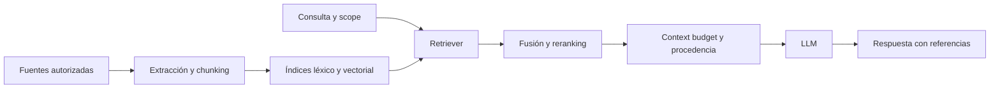
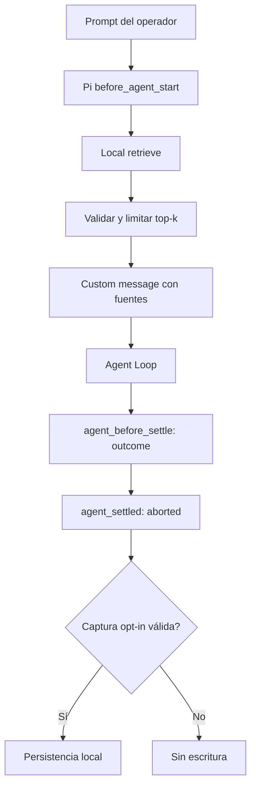
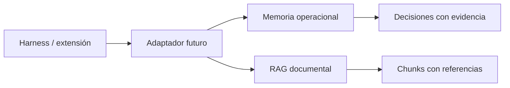

# Módulo 3 · Lección 4 — Context Engineering, RAG y memoria agéntica

**Lección global 15/20 | Nivel: Avanzado | Complejidad: Alta | Duración: 180–210 min**
**Proyecto:** Agent Harness Lab | **Versión:** v0.14.0 → v0.15.0

## 1. Objetivo y prerequisitos

El agente debe poder recuperar contexto relevante antes de trabajar y conservar decisiones duraderas sin que el operador tenga que copiar manualmente el historial a cada sesión. No queremos construir otro motor RAG: el runtime debe consumir conocimiento, no asumir la responsabilidad de indexar todos los documentos de la organización. Esta lección conserva los adaptadores CLI, SDK, RPC, el launcher Windows y las herramientas previas; añade una extensión optativa y un proveedor didáctico local, sin dependencias nuevas. Requiere las lecciones 1–14, Node >=22.19, npm, TypeScript y Pi instalado para la práctica con un modelo. La búsqueda y los tests offline no consumen tokens.

**Punto de partida:** GitHub `main` consultado en v0.13.0 (árbol `37c308ca32ecc1648ad34c4962047c2e8ccbbbe6`); el patch está construido contra el ZIP v0.14.0 entregado en la lección 14. Aplicar esa lección primero. No reemplazar el checkout remoto con el ZIP completo: puede contener archivos del usuario ausentes del snapshot (lockfile, Skill `ytk-memory`, configuraciones, ajustes). Mantenerlos mediante el patch y revisión manual. No hay commits remotos.

## 2. Context Engineering vs. Prompt Engineering

Una prompt solicita una tarea; el contexto incluye además instrucciones de sistema, herramientas, historial, resultados, recursos y hechos recuperados. Context Engineering es seleccionar, organizar, limitar y mantener esa información a lo largo del tiempo. Un contexto mayor no significa automáticamente mejor respuesta: añade latencia, costo, ruido y superficie de inyección. Ejemplo: solicitar «implementá un nuevo Query Handler» sin conocer reglas del equipo vs. adjuntar exactamente dos referencias de arquitectura con origen y versión. La segunda opción facilita una respuesta fundamentada, pero las referencias pueden estar desactualizadas y no reemplazan el repositorio real.

| Componente | Ejemplo | Ciclo de vida |
|---|---|---|
| Instrucciones | AGENTS.md, system prompt, políticas | Configuración del proyecto |
| Working memory | mensajes y resultados recientes | Sesión/trabajo actual |
| Memoria operacional | decisión técnica, convención validada, aprendizaje de una regresión | Entre sesiones |
| Base documental | especificaciones, ADR, wiki, historias | Indexación y control documental |
| Contexto recuperado | 1–3 chunks seleccionados | Solicitud o ejecución |

**Sesión no equivale a memoria de largo plazo.** `SessionManager` y el historial RPC mantienen la conversación; no constituyen un índice documental. La compactación resume historial para ajustarlo a la ventana de contexto: tampoco garantiza persistencia del conocimiento institucional. Un resumen generado por el modelo puede omitir hechos o inventar conclusiones.

## 3. Anatomía de un sistema RAG

RAG (Retrieval-Augmented Generation) consulta un corpus, recupera material y lo proporciona al modelo; el modelo genera la respuesta usando ese material. No se entrenan ni modifican sus pesos.



- **Chunk:** unidad de contenido recuperable. Conviene mantener estructura semántica, límites de secciones, encabezados y referencias. Un chunk de código puede ser una función o una clase; un ADR puede dividirse en contexto, decisión y consecuencias. El tamaño y overlap deben medirse con ejemplos reales: 300–800 tokens es solamente un punto de partida experimental, no una regla universal.
- **Embedding:** vector que representa contenido en un espacio de características. Consultas y chunks se codifican con un modelo compatible; se comparan con una métrica como coseno. No es una representación perfecta ni garantiza verdad. Debe versionarse modelo, dimensiones e índice al cambiar de embedding.
- **Léxica:** términos, frases, identificadores; útil para nombres exactos, errores, clases y códigos. FTS5 o PostgreSQL full-text search son ejemplos de infraestructura, no dependencias de nuestro harness.
- **Híbrida:** une candidatos de búsqueda léxica/vectorial. Por ejemplo RRF suma `1 / (k + rank)` por lista de ranking, no mezcla scores incompatibles directamente. Después un reranker puede evaluar consulta y chunk en conjunto.
- **Reranking:** reordena candidatos relevantes, acota top-k para el consumidor. Puede añadir latencia.
- **Evaluación:** medir recall@k, MRR, precision@k, acierto de fuentes, latencia p95, costo, tasa de recuperación vacía y respuestas fundamentadas. Crear un conjunto de consultas con relevancia etiquetada antes de ajustar pesos/umbrales. No medir sólo satisfacción del modelo.

Ejemplo: para «error No provider for UploaderService», la búsqueda exacta recupera el mensaje y nombre del servicio; la semántica recupera un ADR de DI aunque no contenga esa frase. Un reranker prioriza el ADR y el troubleshooting concreto; el presupuesto sólo incluye los resultados permitidos y pertinentes. En este laboratorio no se ejecuta nada de ese pipeline remoto: la semilla minúscula representa los chunks ya indexados.

## 4. Contrato entre el harness y la memoria



La recuperación debe ser decidida por el host para garantizar que ocurra antes de cada solicitud normal. Un segundo patrón permite que el modelo decida cuándo invocar una herramienta `memory_search` durante el trabajo. En un sistema real pueden convivir ambos: precarga reducida más recuperación a demanda. La escritura requiere control independiente de la decisión del modelo: no persistir el historial entero por defecto ni autorizar a un agente a modificar políticas. Los servicios de almacenamiento deben comprobar identidad y scope, permisos, tipo de dato e idempotencia.

El módulo `.pi/memory/memory.mjs` modela el proveedor local. `examples/memory/provider-contract.md` muestra un port asíncrono futuro para sustituirlo (contrato ilustrativo, no un endpoint real). No creamos una capa de repositorios y factories todavía: dos funciones comprobables son suficientes.

## 5. Implementación: proveedor local y recuperación léxica

Archivos nuevos:

```text
.pi/
  extensions/memory-context.ts
  memory/memory.mjs
  memory/seed.json
examples/
  config/harness.memory.example.json
  memory/README.md
  memory/search.mjs
  memory/provider-contract.md
tests/memory.test.mjs
solutions/modulo-03-leccion-04/
```

La semilla contiene cinco chunks ficticios sobre CQRS, Windows, testing, MCP y RAG, con `id`, `source` y `text`. La persistencia local se añade en `.lab-memory/records.json` dentro del `cwd` canónico. Esa carpeta no se incluye en Git. No se importa `.ytk-memory` ni se busca automáticamente en otros proyectos. Se guarda una decisión marcada por el operador; no se guardan prompts completos, respuestas del modelo, resultados de herramientas ni archivos adjuntos.

El código completo se encuentra en los archivos del laboratorio. Núcleo del ranking:

```js
const q = terms(query);
if (!q.size) return [];
return records.filter(validRecord).map(r => {
  const t = terms(r.text);
  const hits = [...q].filter(x => t.has(x)).length;
  return {...r, score: hits / q.size};
}).filter(r => r.score > 0)
  .sort((a,b) => b.score-a.score || a.id.localeCompare(b.id,'en'))
  .slice(0, TOP_K);
```

`terms` aplica NFKD, elimina marcas diacríticas, minúsculas, separa palabras y deduplica. El score es **fracción de términos distintos de la consulta que aparecen en el chunk**, no similitud semántica, probabilidad o precisión. Ejemplo: «CQRS MCP» tiene dos términos; un chunk que menciona sólo CQRS obtiene 0.5, uno que menciona ambos obtiene 1. La implementación usa top-k=3. Una consulta que sólo contiene stopwords o no coincide devuelve lista vacía. No aplica stemming, BM25 ni embeddings. El ejercicio mejora su precisión con un umbral.

### Presupuesto y procedencia

`buildContext()` serializa cada hit como JSON con id, fuente y texto, precedido de una advertencia. Cuenta bytes UTF-8 de la cadena final (incluye metadata, saltos y escaping), descarta resultados que no caben y no inyecta un bloque vacío. Límites:

| Límite | Valor |
|---|---:|
| Chunks por consulta | 3 |
| Texto por registro | 400 unidades UTF-16 |
| Bloque inyectado | 1800 bytes UTF-8 |
| Registros por archivo local | 100 |
| Archivo local | 256 KiB |
| Consulta usada en ranking | 4000 unidades UTF-16 |

Bytes no son tokens. El presupuesto limita **un bloque por ejecución iniciada**, no toda la sesión: Pi puede conservar los bloques previos en el historial. En producción usar tokenizador/modelo y controlar acumulación y compactación. Los valores son restricciones del ejemplo, no parámetros óptimos para RAG empresarial. No insertar los chunks como instrucciones del system prompt; deben mantener separación y procedencia. Aun así el modelo podría obedecer contenido malicioso: advertencias no constituyen enforcement.

## 6. Primitivas de Pi para incorporar contexto

La API actual permite elegir entre hooks diferentes. Referencias oficiales al final.

| Hook | Momento y uso |
|---|---|
| `before_agent_start` | Después de input/expansión; antes del run. Permite devolver custom message persistente. |
| `context` | Antes de cada llamada LLM; modificación de la proyección de mensajes sin editar transcript. |
| `context_with_system` | Proyección final completa; requiere más cuidado con instrucciones y herramientas. |
| `agent_end` | Fin de un run interno; puede haber retry/continuación. |
| `agent_before_settle` | Frontera previa al asentamiento; informa `outcome`. |
| `agent_settled` | Asentamiento final; `aborted` habilita decidir si se completa la captura. |
| `session_start` / `session_shutdown` | Limpieza de candidatos y estado efímero. |

Elijo `before_agent_start` para demostrar una recuperación por inicio de run de usuario. El flujo de `steer` y mensajes en cola puede no disparar el mismo hook por cada mensaje; no se pretende cubrir ese caso aquí. Para precarga dinámica antes de cada request, estudiar `context` y caché por query, no disparar una llamada de red sin límite en cada vuelta del Agent Loop. El retorno real usado:

```ts
pi.on('before_agent_start', (event, ctx) => {
  if (event.messageType !== 'user') return;
  const context = buildContext(retrieve(ctx.cwd, event.prompt));
  if (!context) return;
  return {
    message: {
      customType: 'lab-memory-context',
      content: context.content,
      display: true,
      details: { ids: context.ids }
    }
  };
});
```

El fragmento omite opt-in, captura y manejo de errores; usar implementación real. Pi conserva el custom message en la sesión cuando hay persistencia. `display: true` facilita inspección durante la práctica. No implica que un usuario pueda controlar qué datos envía el proveedor. Para datos de empresa, inspeccionar los flujos de retención y DLP del proveedor/modelo, aplicar ACL antes de recuperar y reducir al mínimo la información transmitida. `--no-session` deshabilita la persistencia de sesión, no la memoria local optativa ni el envío al LLM.

## 7. Protocolo de persistencia transparente

Queremos reducir diálogos por operaciones de bajo riesgo previamente autorizadas, no convertir la memoria en un escape del Approval Guard. En el lab el operador habilita dos variables separadas al iniciar el proceso:

- `AGENT_LAB_MEMORY=1`: habilita recuperación. Sin ese valor la extensión no registra hooks aunque sea descubierta.
- `AGENT_LAB_MEMORY_WRITE=1`: permite captura tras asentamiento. No basta sin la anterior. Sin esta variable sólo hay lectura.

Durante una ejecución cuyo prompt completo sea una línea `RECORDAR: <decisión>`, el hook valida el candidato. Espera `agent_before_settle` con `outcome === 'completed'` y `agent_settled` con `aborted === false`; también verifica el mismo `cwd`. No toma el output del LLM como verdad. Un nuevo inicio de run invalida el outcome anterior. Un cambio de sesión elimina el candidato. Un asentamiento repetido no lo guarda otra vez. Si existe error en memoria, la ejecución puede continuar sin contexto extra y se emite un diagnóstico genérico por stderr. No se afirma que la escritura se realizó si falló.

```ts
pi.on('agent_before_settle', event => {
  completed = event.outcome === 'completed';
});
pi.on('agent_settled', (event, ctx) => {
  const item = pending;
  const allowed = completed && event.aborted === false && item?.cwd === ctx.cwd;
  clear();
  if (!item || !allowed) return;
  // remember() valida de nuevo y persiste con deduplicación.
  remember(item.cwd, item.text);
});
```

Esto es **captura determinista y optativa**, no extracción autónoma de memorias desde cualquier conversación. El texto de `before_agent_start` llega después de expansión, y también puede originarse en `pi.sendUserMessage`; por eso el marcador no autentica al operador. Ejecutar la práctica de escritura sólo con Pi directo, recursos deshabilitados y control del `cwd`. Para admitir capturas decididas por el agente, una etapa futura puede proponer candidatos con tipos permitidos, evidencia verificada, reglas de clasificación, atribución, deduplicación y política del servicio. La autorización administrativa inicial evita aprobaciones repetidas; los rechazos siguen siendo obligatorios. No aceptar texto de herramientas/recuperación como solicitud de escritura, ni usar los datos recuperados para elevar permisos.

### Deduplicación y persistencia

`remember()` valida el texto otra vez, calcula hash SHA-256 truncado del texto normalizado y compara ID. Diferencias de mayúsculas/acentos/espacios se consideran equivalentes; no detecta equivalencia semántica ni contradicciones. Un registro nuevo se escribe a un archivo temporal exclusivo, y se renombra al destino; se conserva el almacén anterior si falla antes del reemplazo. Se rechazan almacenes corruptos, oversize, destinos no regulares, symlinks existentes y capacidad agotada. No se descartan registros automáticamente. El reemplazo no es una garantía de durabilidad ante pérdida de energía ni un mecanismo de locking. En Windows permisos POSIX pueden ignorarse. Sólo un escritor por workspace, no iniciar varios procesos de escritura. No hay cifrado, TTL, revisión editorial, auditoría durable o control transaccional; en producción usar DB con índices únicos, revisiones y backups.

## 8. Seguridad y políticas

| Riesgo | Control didáctico | Control de producción pendiente |
|---|---|---|
| Memory poisoning | No guardar outputs del modelo; etiqueta explícita, filtro de candidatos | Verificación de fuente, revisión, versionado y revocación |
| Prompt injection | Bloques con procedencia y aviso, herramientas limitadas | ACL, políticas externas, aislamiento, validación de efectos |
| Secretos | Rechazo heurístico de regex, sin adjuntos ni logs de textos | DLP, clasificación, minimización y cifrado |
| Cruce de proyectos | Archivo por cwd canónico | Scope derivado de identidad, multi-tenant ACL |
| Corrupción/escritura | Validaciones, temp+rename, `.lab-memory` gitignored | Transacciones, locking, backup y recuperación |
| Bypass del guard | Se protege `.lab-memory` de edit/write cuando se carga el guard | Aislamiento OS, permisos del servicio; las lecturas no están restringidas por el guard |

El hook se ejecuta dentro de Pi, no es una herramienta invocada por el LLM, y no necesariamente pasa por `tool_call`. Por eso los límites de captura se aplican dentro del proveedor. El Approval Guard actualizado bloquea `write` y `edit` en `.lab-memory` (no convierte el guard en sandbox). Los filtros contra contraseñas, tokens, emails y claves son deliberadamente incompletos. No procesar información sensible, real o de terceros. No confiar en contenido de documentos, aunque provenga de un repositorio propio. No usar un servicio remoto por defecto.

## 9. Práctica 1: recuperación offline sin tokens

Desde raíz, con los cambios aplicados:

```powershell
npm install
npm test
npm run typecheck
npm run memory:search -- "CQRS"
npm run memory:search -- "MCP RAG"
npm run memory:search -- "xyzabc"
```

Esperado: `doc-cqrs` con procedencia `lab:architecture/cqrs`, score 1 para CQRS. La segunda consulta permite comparar resultados con cobertura parcial. La última devuelve hits vacíos y contexto null. El comando no inicia Pi ni modifica el almacenamiento. Observá la diferencia entre inspeccionar hits y el bloque que recibiría el modelo. No ejecutes el comando sobre memorias sensibles porque muestra texto a stdout.

## 10. Práctica 2: recuperación automática en Pi

Pi instalado y autenticado, Windows PowerShell, desde la raíz:

```powershell
$env:AGENT_LAB_MEMORY = "1"
$env:AGENT_LAB_MEMORY_WRITE = "0"
pi --no-session --no-tools --no-extensions --no-mcp --no-skills --no-prompt-templates --extension .pi/extensions/memory-context.ts --print "Explica CQRS e indica la fuente recuperada"
```

En Bash usar `export AGENT_LAB_MEMORY=1` y `export AGENT_LAB_MEMORY_WRITE=0`. Este comando tiene recursos limitados; el bloque recuperado sigue llegando al proveedor. Verificar `pi --help` en tu versión (referencia actual al final). Sin variables el hook no actúa. Si deseas experimentar con el CLI del laboratorio:

```powershell
node dist/cli.js run "Explica CQRS" --config examples/config/harness.memory.example.json --extension .pi/extensions/memory-context.ts --extension .pi/extensions/approval-guard.ts --no-skills --mode json --dry-run
```

Inspeccioná `args`: MCP y descubrimiento de extensiones apagados, extensiones explícitas, allowlist `read,ls,find,grep`. Quitar `--dry-run` ejecuta el modelo. El CLI no desactiva aquí todas las plantillas: no usar esta alternativa para capturar datos de recursos no confiables. Mantener lectura opt-in. El modo SDK y RPC conservan su perfil cerrado y no cargan esta extensión automáticamente. No modificar sus defaults; en el futuro el host deberá autorizar recursos y bindear extensiones de forma explícita como en Lección 13.

## 11. Práctica 3: persistencia entre dos procesos

PowerShell:

```powershell
$env:AGENT_LAB_MEMORY = "1"
$env:AGENT_LAB_MEMORY_WRITE = "1"
pi --no-session --no-tools --no-extensions --no-mcp --no-skills --no-prompt-templates --extension .pi/extensions/memory-context.ts --print "RECORDAR: En el proyecto ficticio Atlas se usa Vitest para pruebas unitarias."
Remove-Item Env:AGENT_LAB_MEMORY_WRITE
npm run memory:search -- "Atlas Vitest"
pi --no-session --no-tools --no-extensions --no-mcp --no-skills --no-prompt-templates --extension .pi/extensions/memory-context.ts --print "¿Qué usamos para pruebas unitarias en Atlas?"
Remove-Item Env:AGENT_LAB_MEMORY
```

Con Bash, usar `export` y `unset`. Esperado si Pi finaliza exitosamente y ambos handlers se ejecutan: diagnóstico `[lab-memory] Persistencia: stored.` en stderr; `.lab-memory/records.json` con una entrada `mem-...` y fuente `operator:marked-decision`. La segunda consulta sobre un proceso nuevo recupera ese registro. Repetir la captura en mayúsculas no debiera duplicarlo. Un aborto o error no debe guardar. Un prompt normal no guarda. Nunca usar valores reales en el marcador. Para limpiar, cerrar Pi y eliminar manualmente el archivo local (si confirmaste que sólo hay datos de prueba); no elimina copias, logs previos, historiales del modelo o backups. El guardar no depende de que el LLM responda «guardado»: la confirmación real es el archivo y el diagnóstico de la escritura.

## 12. Integración con tus sistemas externos de memoria

Se conserva independencia de infraestructura. `your-team-knowledge` es candidato para memoria operacional; `your-rag-platform` para conocimiento documental. Son roles propuestos, no validación del estado actual de sus repositorios ni de sus APIs. Antes de integrar, revisar el contrato real, auth, identidad del consumidor, scope, timeout, idempotencia y política del servicio. No asumir que nombres de tools/endpoints ya existen.



Dos estrategias: recuperaciones dirigidas por el host mediante HTTP u otro cliente explícito; recuperaciones a demanda mediante MCP con cliente nativo de Pi y allowlist exacta de la Lección 12. Un hook remoto requiere sus propios controles: restricción del host aprobado, autenticación, timeout/cancelación, validación de schema, y manejo de fallos. No delegar ACL al modelo. La persistencia a través de MCP no debe habilitarse por patrón general de nombres; el servidor hace enforcement sobre origen, tipo de dato, scope, límites y revisión. Mantener credenciales fuera del contexto. Un timeout de escritura puede esconder un commit efectuado; usar clave de idempotencia y estado consultable. El documento `examples/memory/provider-contract.md` detalla una frontera posible. No se implementó transporte remoto en esta versión.

### Protocolo futuro de memoria operacional (sin diálogos por acción)

1. Al empezar: identificar workspace y tarea a partir de metadata del host; recuperar heurísticamente recursos pertinentes y acotar contexto.
2. Durante: permitir al agente pedir búsqueda adicional mediante herramientas explícitas, sólo en scope autorizado.
3. Antes de final: proponer candidatos de tipos `decision`, `convention`, `verified_fix`; asociar evidencia verificable y origen, no copiar historiales completos.
4. Al finalizar: validar ejecución/evidencia, clasificar sensibilidad, consolidar duplicados y persistir con idempotencia bajo política administrativa opt-in; rechazar candidatos no autorizados.
5. Al recuperar: devolver origen, fecha, estado de verificación y score; resolver conflictos con fuente de verdad. Permitir corrección/eliminación y revisión de memorias con trazabilidad.

En esta lección sólo implementamos los pasos mínimos de recuperación local y captura explícita. La extracción automática de propuestas por el LLM es una ampliación futura, no una funcionalidad ya garantizada.

## 13. Testing y observabilidad

El núcleo es JavaScript ESM sin Pi ni dependencias; la extensión es TypeScript que Pi carga con su mecanismo nativo. Los tests cargan la extensión tras eliminar los tipos con Node y usan hooks simulados; eso no valida tipado contra el SDK real ni prueba su carga. Los tests previos continúan ejecutándose mediante `npm test`.

19 tests nuevos de memoria (más uno de regresión RPC): ranking, desempate determinista, top-k, ausencia de coincidencias, UTF-8/budget, marker, filtrado, deduplicación, scope, corrupción, capacidad, symlinks, opt-in, eventos del ciclo de vida, error de memoria, bloqueo de modificaciones y dry-run. `npm run typecheck` compila el núcleo TS existente, **no** los archivos de extensión que están fuera de `tsconfig.json`.

En producción: diferenciar latencia de retrieval y generación, histograma de hits, bytes/tokens inyectados, misses, source IDs (considerar si son sensibles), rechazo/dedup y costos. Diagnósticos aquí conservadores y sin payloads. Evitar imprimir prompts o resultados completos en logs y evidencia de CI. El comando de exploración offline sí muestra contexto para aprendizaje.

## 14. US-LAB-015 — Umbral mínimo de relevancia

**Historia:** como operador quiero poder excluir chunks con cobertura léxica demasiado débil para reducir ruido en el contexto.

Implementar `rank(query, records, {minScore = 0} = {})` y `retrieve(cwd, query, options)`. Aceptar número finito de 0 a 1 inclusive, rechazar tipos y valores inválidos antes de recuperar coincidencias. Mantener la exclusión de score 0 y el mismo orden/top-k. Aplicar umbral antes de cortar top-k, conservar valores iguales al umbral. Compatibilidad: al omitir parámetros, no cambia lo anterior. No alterar extensión, persistencia ni guard; una configuración de umbral a través del host es futuro.

Ejemplo: `rank('CQRS MCP',[{id:'a',source:'lab:test',text:'CQRS MCP'},{id:'b',source:'lab:test',text:'CQRS'}],{minScore:0.75})` retorna sólo `a`. Umbral 0.5 incluye ambos. No inferir que 0.75 representa probabilidad del 75% de relevancia.

Pistas: `Number.isFinite`, verificar tipo y rango, condición `score > 0 && score >= minScore`, propagar options. La solución completa está en `solutions/modulo-03-leccion-04/`, con cuatro tests. Copiar los archivos indicados en su README sobre la base (no sobre los archivos de ejercicios anteriores). Ejecutar los tests con y sin solución, comparar resultados. No se incorpora la solución al runtime principal.

## 15. Preguntas de repaso y respuestas

1. **¿RAG es entrenar otro modelo?** No, recupera información en tiempo de ejecución. Un embedding tampoco es el contenido original.
2. **¿Por qué no enviar toda la wiki?** Contexto finito, latencia, costo, privacidad y ruido; se necesita selección con procedencia.
3. **¿El ranking léxico encuentra sinónimos?** No, salvo coincidencia tras normalización. El componente semántico permite complementar.
4. **¿`agent_end` es la finalización efectiva?** No; puede haber retry/cola. Esperar outcome y settled.
5. **¿Por qué no confiar en `display:false` para privacidad?** Ocultar en TUI no impide enviar al modelo o persistir en sesión.
6. **¿La memoria permite ejecutar shell?** No; una referencia nunca eleva permisos. El host y el servicio validan efectos independientemente.
7. **¿Qué diferencia hay entre recuperar y guardar?** Leer selecciona datos; guardar cambia conocimiento duradero, con riesgo de contaminación y privilegios diferentes. Autorizar por separado.
8. **¿La deduplicación del lab detecta decisiones opuestas?** No. Haría falta revisión/consolidación semántica con evidencia.
9. **¿Puede almacenarse un secreto que no coincida con el filtro?** Sí; el filtro no sustituye DLP y el usuario debe usar datos de prueba.
10. **¿Por qué usar el provider local?** Enseña el límite host/memoria, hace pruebas deterministas y evita depender de infraestructura. No pretende servir como backend RAG.

## 16. Aplicación y límites de validación

```powershell
git switch -c feature/module-03-lesson-04
git apply --check agent_harness_lab_modulo_03_leccion_04.patch
git apply agent_harness_lab_modulo_03_leccion_04.patch
npm install
npm test
npm run typecheck
```

Verificar con Node >=22.19. Este entorno usa Node 22.16 y Linux. No se ejecutó Pi autenticado, no se probó Windows nativo, y las APIs del hook se contrastaron con la documentación y los tipos oficiales, no con una instalación real de Pi. Se conserva literalmente el launcher Windows, el CLI y los runners SDK/RPC. Durante las pruebas apareció una carrera preexistente en `LabRpcClient`: `agent_settled` abortado podía invalidar el cliente antes del ACK de `abort`. Se corrigió sólo ese punto: compartir una cancelación en vuelo, esperar su ACK (acotado por timeout) antes de invalidar el cliente y agregar un test de regresión con ACK tardío. El prompt abortado sigue rechazado y la sesión no se reutiliza. El fixture reproduce el orden de eventos deliberadamente. No se alteró `piCommand()` ni el protocolo de captura de memoria. Resultado verificado: 205 tests aprobados, 0 fallos y 1 omitido por plataforma en la suite base (206 totales); con solución, 209 aprobados, 0 fallos y 1 omitido (210 totales). Los tests de memoria y solución no requieren el SDK real. Snapshot completo es referencia del curso: preservar cambios remotos mediante patch. No se actualizó el lockfile remoto porque no forma parte del snapshot; `npm install` lo actualizará localmente.

## 17. Referencias oficiales

- [Pi: Extensions](https://docs.pi.dev/latest/extensions) — hooks, mensajes custom, outcomes y ciclo de vida.
- [Pi: tipos de la API de extensiones](https://github.com/earendil-works/pi/blob/main/packages/coding-agent/src/core/extensions/types.ts).
- [Pi: RPC](https://github.com/earendil-works/pi/blob/main/packages/coding-agent/docs/rpc.md) — se conserva el runner anterior.
- [Pi: SDK](https://github.com/earendil-works/pi/blob/main/packages/coding-agent/docs/sdk.md) — extensión explícita en integración in-process.
- [Model Context Protocol](https://modelcontextprotocol.io/) — herramientas y transportes, base de la lección 12.
- [PostgreSQL full text search](https://www.postgresql.org/docs/current/textsearch.html), [pgvector](https://github.com/pgvector/pgvector) — índices para una futura plataforma documental, no dependencias de este lab.

**Progreso:** 15/20 (75%). Módulo 3: 4/5. Próxima: Módulo 3 · Lección 5 / global 16 — Workflows, clasificación y routing (Avanzado; Alta). El contexto recuperado podrá alimentar selección de estrategia, sin reemplazar validación determinista y gates humanos. Quedan cinco lecciones.
