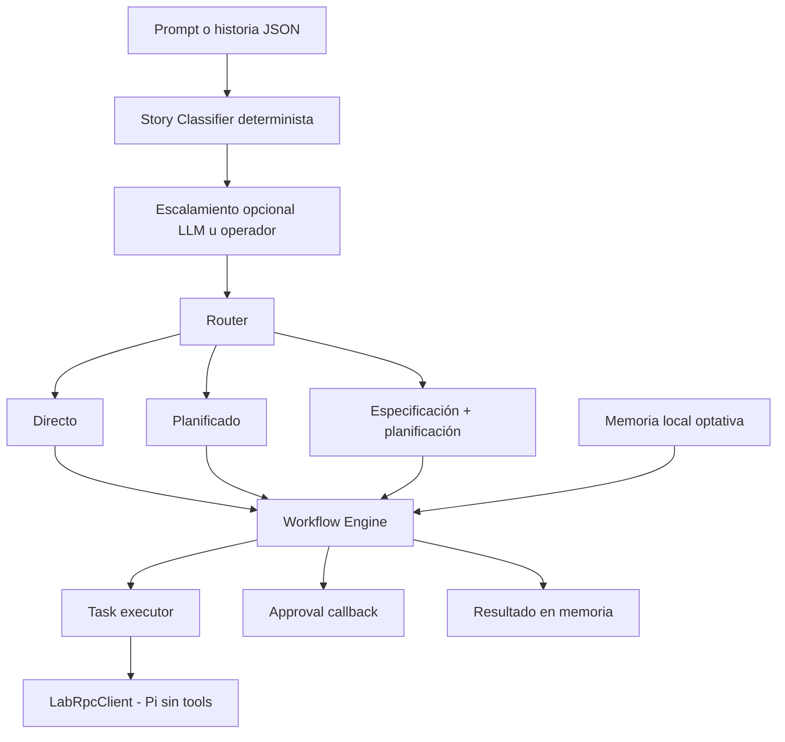

# Módulo 3 · Lección 5 — Workflows, Story Classifier y Routing

**Lección global 16/20 · Agent Harness Lab v0.16.0**
**Nivel:** avanzado · **Complejidad:** alta · **Duración sugerida:** 180–240 minutos.
**Base:** snapshot v0.15.0, código incremental. Repo oficial del curso: https://github.com/lucasjaviluna/agent-harness-lab.

## 1. Objetivo y punto de partida

Ya sabemos invocar Pi desde CLI, SDK y RPC; configurar contexto, Skills, extensiones y herramientas; consumir MCP; observar eventos; controlar autorizaciones e incorporar conocimiento. En esta unidad conectamos parte de esas primitivas en un **proceso de trabajo determinista**. No implementamos otro Agent Loop, un DSL de workflows, un sistema distribuido ni una dependencia de LangChain.

La diferencia entre un agente y un workflow importa: el agente decide cómo responder a una solicitud dentro de sus posibilidades; el workflow establece qué pasos existen, cómo se ordenan, cuándo se detienen y quién autoriza el avance. El modelo puede producir una propuesta y sugerir que un caso es complejo, pero no puede eliminar una aprobación necesaria, ejecutar un comando desde un resultado, ni marcar por sí mismo que un gate fue aprobado.

**Alcance de esta versión.** Los tres workflows generan artefactos textuales; no modifican archivos, no ejecutan tests ni realizan commits. El paso `review` es una revisión de una propuesta, no un verificador determinista de implementación. Los gates autorizan avanzar a otra etapa textual, no autorizan cambios reales. El Módulo 4 desarrollará políticas comunes, evidencia durable y ejecución de cambios con controles efectivos. Esta frontera evita introducir accidentalmente escrituras sin el guard unificado.

### Resultados de aprendizaje

- Modelar una historia de usuario con criterios de aceptación y señales de riesgo.
- Diferenciar clasificación determinista, heurísticas y sugerencia LLM.
- Seleccionar rutas directas o con especificaciones sin burocracia innecesaria.
- Definir roles, etapas, artefactos y dependencias explícitas.
- Implementar un motor secuencial probado con ejecutores inyectados.
- Capturar decisiones del operador y detenerse ante fallos, rechazo o cancelación.
- Reutilizar el adaptador RPC y la recuperación de memoria de la unidad anterior.
- Comparar el alcance de esta unidad contra una plataforma SDLC real.

## 2. Arquitectura



La capa de aplicación usa TypeScript y depende de un contrato pequeño: `execute(stage, prompt)` y `approve(stage, artifact)`. El motor no conoce subprocesses, modelos, terminal, Azure DevOps, bases de datos ni MCP. El adaptador CLI implementa esos contratos usando `LabRpcClient` o respuestas simuladas. Esto es inversión de dependencias aplicada a una necesidad concreta: ejecutar tests sin iniciar Pi.

El proyecto real conserva `src/runtime.ts`, `src/sdk-runner.ts`, `src/rpc-client.ts`, `src/rpc-runner.ts`, `src/cli.ts` y los módulos de memoria tal como estaban en v0.15.0 del snapshot. No introducimos una interfaz universal que intente esconder todas las diferencias del CLI, RPC y SDK. El contrato del workflow representa sólo las operaciones que necesita ahora.

| Archivo | Responsabilidad |
|---|---|
| `src/story-classifier.ts` | Contrato, validación y clasificación de entrada |
| `src/workflow.ts` | Definiciones, ruta, prompts y motor |
| `src/workflow-cli.ts` | Adaptación a terminal, perfiles, memoria y Pi RPC |
| `examples/workflows/*.json` | Historias ficticias y configuración adicional |
| `tests/workflow.test.mjs` | Tests del contrato, del motor, del CLI y de conexión RPC simulada |
| `solutions/modulo-03-leccion-05/` | Ejercicio resuelto por separado |

## 3. La historia como contrato

Un prompt libre es útil, pero no ofrece evidencia suficiente sobre alcance y riesgo. Una historia estructurada permite que el PO, analista o desarrollador declare los datos que realmente conoce. Los ejemplos no representan historias de tu empresa.

```json
{
  "id": "US-201",
  "description": "Corregir el texto del botón de cancelar en el formulario de perfil.",
  "scope": "localized",
  "acceptanceCriteria": ["El botón muestra Cancelar", "No se modifica el comportamiento"],
  "risks": {
    "security": false,
    "dataMigration": false,
    "breakingChange": false,
    "crossRepo": false
  }
}
```

El scope puede ser `localized`, `feature`, `cross-cutting` o `unknown`. `risks: null` significa no evaluado; **no significa ausencia de riesgo**. Si se proporcionan riesgos, las cuatro propiedades son obligatorias y booleanas. El parser rechaza campos inesperados, descripciones vacías y entradas demasiado grandes. No acepta propiedades como `skipApproval` o `tools` dentro de la historia. Identificador hasta 64 caracteres, descripción hasta 4000 y hasta 12 criterios de 400 caracteres cada uno.

Una futura integración de Azure DevOps deberá normalizar el título, descripción, criterios y metadatos de impacto a este contrato. La integración MCP de la Lección 12 puede ser una de las fuentes, pero no se conecta a Azure en este ejercicio. Tampoco suponemos que los campos de una US leída desde un sistema de tickets son confiables o que sus criterios han sido verificados.

## 4. Story Classifier

No confundir volumen de texto con dificultad. Una historia con tres líneas que toca autenticación puede ser más riesgosa que una con diez criterios de UI. La complejidad depende del alcance, dependencias, incertidumbre y consecuencias de un error.

Reglas, en orden:

| Señal | Resultado mínimo |
|---|---|
| Alcance transversal o alguno de los cuatro riesgos positivos | complex |
| Términos sensibles de la lista heurística, por ej. JWT, migración o pagos | complex |
| Alcance no localizado, riesgos desconocidos o sin criterios | medium |
| Alcance localizado, riesgos declarados negativos y criterios presentes | simple |

La heurística textual sólo eleva; utiliza normalización y coincidencias de palabras, no comprensión semántica. Puede fallar con sinónimos y pluralizaciones o elevar ejemplos inofensivos. No prueba que una tarea sea segura. El operador debe revisar las declaraciones y puede elevar manualmente el nivel, nunca reducirlo por CLI. Para automatización de producción se necesitará análisis de impacto y una política de riesgo independiente.

```ts
import { classify, parseStory } from './dist/story-classifier.js';
import { readFileSync } from 'node:fs';
const story = parseStory(JSON.parse(readFileSync('examples/workflows/simple.json','utf8')));
console.log(classify(story));
```

`classify` devuelve `level` y `reasons`. Las razones son información para el operador, no decisiones ejecutables.

### Texto libre

```bash
npm run workflow:run -- "Cambiar un texto de la UI"
```

El clasificador no sabe si el cambio es realmente localizado. Devuelve medium como mínimo. Una historia estructurada sí puede alcanzar simple. Si la descripción contiene una señal sensible, el nivel sube a complex.

### Clasificación híbrida con LLM

La ruta puede incorporar una segunda opinión mediante `--llm-classify` (modo live). Se solicita una respuesta JSON de forma estricta, por ejemplo:

```json
{"level":"complex"}
```

`applyModelHint` valida el objeto, rechaza campos desconocidos y acota su tamaño. La complejidad final es el máximo de la clasificación determinista y la sugerencia. JSON malformado eleva a complex; un fallo de transporte/modelo detiene el CLI antes del workflow. No se interpreta código, Markdown ni instrucciones en la salida. Esta es una política didáctica conservadora, no una medida de exactitud del clasificador. La prueba autónoma del clasificador se hace sin tokens.

```ts
import { applyModelHint } from './dist/story-classifier.js';
const initial = {level:'complex', reasons:['Migración']};
// Resultado permanece complex, incluso si el modelo propone simple.
console.log(applyModelHint(initial, '{"level":"simple"}'));
```

En producción mediríamos sobre historias históricas etiquetadas por humanos: matriz de confusión, falsos negativos de alto riesgo, concordancia, latencia y coste. No tenemos un conjunto etiquetado ni reportamos métricas inventadas.

## 5. Router: tres estrategias

Los nombres de los niveles forman parte del contrato, no de un prompt. El router devuelve etapas conocidas, en orden explícito.

```text
simple  : propose ────────────────────> review
medium  : plan -> approve-plan -> propose -> review
complex : specify -> approve-spec -> plan -> approve-plan -> propose -> review
```

- `simple`: propuesta directa para cambios bien acotados; revisión textual posterior.
- `medium`: requiere plan previo y autorización humana antes de producir una propuesta de implementación.
- `complex`: exige especificación y revisión humana antes del plan; otro gate antes de la propuesta.

No se crea un cambio OpenSpec todavía. `specify` produce un borrador de especificación, no un artefacto OpenSpec válido por sí mismo. La Lección 18 implementará SDD con OpenSpec.

Las rutas nunca se leen de la salida del LLM. Una configuración de confianza permite agregar instrucciones por etapa, sin eliminar etapas obligatorias ni incorporar herramientas.

```json
{"stageInstructions":{"plan":"Considera Angular y .NET, CQRS y E2E cuando correspondan.","review":"Distingue hallazgos confirmados de hipótesis."}}
```

El archivo de ejemplo está en `examples/workflows/workflow.config.json`. El parser limita la longitud de cada instrucción y rechaza propiedades que intenten modificar gates o capacidades. Extender rutas completas será una decisión posterior, cuando exista validación de invariantes y versionado de workflows. Evitamos construir un framework por anticipado.

## 6. Workflow Definition y roles

Cada etapa se representa con una unión discriminada (`kind: task | gate`). Las tareas contienen un identificador, rol y una instrucción; los gates especifican exactamente qué artefacto se revisa. El motor usa esos objetos, no adelanta pasos por interpretar una respuesta textual.

| Etapa | Rol | Artefacto esperado |
|---|---|---|
| specify | analista | Alcance, requisitos, límites y preguntas abiertas |
| plan | tech lead | Pasos, dependencias, riesgos, pruebas y rollback |
| propose | developer | Propuesta de código/pseudocódigo, cambios hipotéticos |
| review | reviewer | Hallazgos, riesgos y comprobaciones pendientes |

Un rol es una instrucción para el modelo, no un usuario autenticado ni una separación de permisos real. `skillHint: agent-review` indica una Skill candidata para revisión; no se carga automáticamente. En esta versión no hay Skills ni tools activas en el runner RPC. Los perfiles de modelo del Módulo 1 se reutilizan con `--profile` para el flujo completo, no existen modelos por etapa todavía. La arquitectura permite ampliar esto posteriormente sin alterar `runWorkflow`.

## 7. Motor y estados

```ts
export interface WorkflowDeps {
  execute(stage: TaskStageDefinition, prompt: string): Promise<string>;
  approve(stage: GateStageDefinition, artifact: Artifact): Promise<boolean>;
  context?: Context | null;
  signal?: AbortSignal;
}
```

Los nombres `TaskStageDefinition` y `GateStageDefinition` del fragmento representan las variantes de `Stage` en el archivo real (se implementan mediante `Extract<Stage, ...>`).

El motor valida la historia y vuelve a ejecutar el clasificador determinista. Incluso si un consumidor externo suministra simple para una historia complex, se conserva el mínimo. Estados de ejecución:

| Estado global | Significado |
|---|---|
| completed | Todas las etapas textuales requeridas finalizaron y los gates dieron true |
| rejected | Se rechazó o no se pudo obtener una aprobación válida |
| failed | Fallo de etapa o cancelación detectada |

Los resultados por etapa distinguen `completed`, `approved`, `rejected`, `failed` y `skipped`. El fallo de una etapa o el rechazo detiene el flujo y las etapas restantes quedan `skipped`. No se inventan eventos de éxito posteriores. No hay retries del motor; los retries internos que pudiera efectuar Pi son responsabilidad de su runtime. Una ejecución repetida inicia un workflow nuevo, sin resume ni idempotencia durable.

En la implementación verás un bucle secuencial, no una máquina de estados distribuida. Esta decisión facilita el debugging y el razonamiento sobre políticas. Los resultados se almacenan en memoria durante la ejecución y se emiten al finalizar como JSON. **No es auditoría durable ni evidencia criptográfica.** La Lección 17 agregará esa parte. El CLI no escribe automáticamente los artefactos en disco.

## 8. Execution Context y presupuesto

La función `buildStagePrompt` construye un prompt con rol, instrucciones, historia, artefactos anteriores y conocimiento opcional. Utiliza JSON para distinguir datos de instrucciones, pero no hay una garantía de que el LLM ignore ataques de prompt injection. El runtime permanece restringido.

El proveedor de memoria de L15 puede activarse mediante `--memory`. Se llama a `retrieve` y `buildContext` directamente antes del flujo, una vez por historia. El resultado contiene IDs de origen y hasta 1800 bytes de contexto. No se invocan mecanismos de escritura ni se activan las extensiones de memoria. Si la memoria solicitada falla, el CLI detiene la ejecución (no oculta el fallo). No hay conexión a `your-team-knowledge` o `your-rag-platform`; son posibles proveedores independientes.

Las respuestas de cada etapa se limitan a 6000 bytes UTF-8. Si exceden el límite, la etapa falla: no truncamos una propuesta que después podría aprobarse parcialmente. Al enviar una etapa posterior, el contexto incluye las salidas anteriores completas dentro de estos límites. Es un presupuesto de bytes, no una medida exacta de tokens del modelo. En un flujo complejo se preservan hasta cuatro artefactos. Si fuese necesario añadir más etapas, habría que definir un presupuesto global y política de condensación explícita.

Los resultados pueden contener información sensible de la historia y de la memoria recuperada. `live` envía esa información al proveedor autenticado de Pi; usa únicamente información ficticia o autorizada. No habilitamos herramientas por defecto y no pretendemos que esto sea aislamiento OS, protección contra filtraciones o DLP.

## 9. Approval Gates

Cada gate recibe el artefacto específico que debe ser revisado y el callback del operador. El motor sólo considera una aprobación si el callback devuelve el booleano `true`. Valores truthy, rechazo, errores o cancelaciones no se convierten en autorización. La copia entregada a ese callback no permite editar el artefacto original del resultado. El motor tampoco decide si un agente debe eliminar una etapa.

En modo live, el CLI exige stdin y stderr interactivos (TTY). Muestra el artefacto completo como JSON escapado y solicita `APROBAR` (exacto). Respuestas diferentes se rechazan; sin TTY se rechaza el gate. No hay opción `--yes` ni `--decision approve` en live. En modo simulate, la decisión explícita de ejemplo permite recorrer el flujo para aprender; se identifica como simulación y no modifica nada.

Hay dos niveles distintos de autorización:

1. Gate del workflow: autorización para avanzar a otra etapa del proceso.
2. Guard de herramientas: autorización para una operación o destino concreto durante el Agent Loop.

Este módulo implementa sólo el primer nivel del workflow. El nuevo runner no carga el Approval Guard de L9, porque no habilita tools ni extensiones. Cuando se incorporen modificaciones reales, se necesitará que los dos niveles estén activos, con políticas fuera del alcance del modelo. También hace falta identidad y evidencia fiable del aprobador, un límite temporal de aprobación y control de concurrencia. El prompt interactivo de esta lección no tiene expiración automática; Ctrl+C permite salir.

## 10. Runtime: por qué RPC en este ejercicio

El cliente didáctico de L14 permite mantener el proceso separado y correlacionar solicitudes; `prompt()` espera tanto aceptación como asentamiento y valida el resultado final. La documentación de Pi recomienda su cliente RPC exportado para integraciones TypeScript mantenidas y su SDK para integración in-process. Aquí reutilizamos el cliente del laboratorio para aprender con un código que ya conocemos.

La integración de ejemplo utiliza `getState()` inicialmente y `newSession()` antes de cada etapa, reutilizando un solo proceso RPC. De esta manera no hay una cadena opaca de instrucciones heredadas entre roles: el contexto se pasa explícitamente por el host. El agente ejecuta cada etapa de forma secuencial. La configuración reutiliza ejecutable, modelo, proveedor y thinking según el perfil; no importa permisos CLI, MCP, Skills ni extensiones. `--no-tools`, `--no-mcp`, `--no-extensions`, `--no-skills`, `--no-context-files`, `--no-prompt-templates` y `--no-session` son los argumentos del perfil RPC cerrado construido anteriormente.

Al recibir el resultado, cualquier contador inesperado de tools o error de tool hace fallar el paso (detección posterior, no garantía de prevención). La cancelación SIGINT solicita aborto a Pi; la aplicación cierra el cliente en `finally`. Las solicitudes RPC se limitan por timeout individual. El motor genérico espera que el ejecutor cumpla el contrato y su deadline; no ofrece timeout preemptivo para dependencias arbitrarias. El timeout incluye el prompt de cada etapa, no un SLA global del workflow ni la espera de aprobación humana.

Reutilizamos el lanzamiento sin shell y el ajuste de `pi-launcher.js` en Windows de las lecciones anteriores. No se realizan llamadas desde un navegador: en una futura web el RPC debe ejecutarse en un backend que controle credenciales, procesos, directorios y capacidades.

### Ejemplo del motor sin Pi

```js
import { classify, storyFromPrompt } from './dist/story-classifier.js';
import { runWorkflow } from './dist/workflow.js';
const story = storyFromPrompt('Agregar filtro a la lista de beneficios');
const result = await runWorkflow(story, classify(story), {
  execute: async stage => `SIMULADO ${stage.id}`,
  approve: async () => false
});
console.log(result.status); // rejected
console.log(result.steps); // plan completado; gate rechazado; resto omitido
```

Esta prueba no consume tokens y demuestra que las reglas pertenecen al host, no al LLM. No uses callbacks que devuelven `true` automáticamente en un adaptador live.

## 11. Preparar el laboratorio y prácticas

Partir de v0.15.0. Aplicar el patch incremental, no sobreescribir tu repository con el ZIP completo. Los archivos modificados de metadata coinciden por SHA de blob con main al momento de verificar; no se descargó el repo completo. El ZIP es el snapshot del curso, no un backup de tu repositorio. No incluye tu memoria SQLite ni configuraciones privadas. No modifica ni añade dependencias del SDK. Node requerido: >=22.19.0, Pi instalado sólo para `live`.

```bash
git switch -c feature/module-03-lesson-05
git apply --check agent_harness_lab_modulo_03_leccion_05.patch
git apply agent_harness_lab_modulo_03_leccion_05.patch
npm install
npm test
npm run typecheck
```

### Práctica A — plan offline (sin tokens)

```bash
npm run workflow:run -- --story examples/workflows/simple.json
npm run workflow:run -- --story examples/workflows/medium.json
npm run workflow:run -- --story examples/workflows/complex.json
```

Observá `classification`, `stages`, `effectiveTools`, `effectiveSkills` y `contextIds`. Ningún proceso Pi se inicia. El script npm genera logs de build; para consumir exclusivamente JSON ejecutá primero `npm run build` y luego `node dist/workflow-cli.js ...`.

Prueba la incertidumbre y el escalamiento manual:

```bash
npm run workflow:run -- "Actualizar texto del botón"
npm run workflow:run -- "Cambiar autenticación JWT"
npm run workflow:run -- --story examples/workflows/simple.json --level complex
npm run workflow:run -- --story examples/workflows/complex.json --level simple
```

La última instrucción no reduce complex. La primera resulta medium por falta de información. El segundo ejemplo queda complex por señal textual sensible.

### Práctica B — recorrer un flujo simulado

```bash
npm run workflow:run -- --story examples/workflows/medium.json --mode simulate --decision approve
npm run workflow:run -- --story examples/workflows/complex.json --mode simulate --decision deny
```

Omitir `--decision` también rechaza los gates. La simulación no usa modelo, tools ni cambios. Las respuestas están marcadas como `[SIMULADO]`. Para el caso de rechazo esperar estado global `rejected`, exit code 2 y pasos siguientes `skipped`.

### Práctica C — contexto y personalización

```bash
npm run workflow:run -- --memory "Analizar alternativas para CQRS y Handlers"
npm run workflow:run -- --story examples/workflows/medium.json --workflow-config examples/workflows/workflow.config.json
```

El primer resultado muestra IDs recuperados del proveedor de memoria local; selecciona el contexto de tu workspace, incluyendo semilla y memoria local permitida. No incluyas datos privados en archivos a compartir. El segundo muestra cómo enriquecer instrucciones sin cambiar gates.

### Práctica D — live opt-in (requiere Pi y puede consumir tokens)

Desde PowerShell o Bash, en un terminal interactivo y un workspace de prueba:

```bash
npm run workflow:run -- --story examples/workflows/simple.json --mode live
npm run workflow:run -- --story examples/workflows/medium.json --mode live --timeout-ms 120000
npm run workflow:run -- --story examples/workflows/complex.json --mode live --llm-classify
```

Para historias medianas y complejas, revisa cuidadosamente cada propuesta y escribe `APROBAR` sólo si querés seguir. No se ejecutarán cambios reales. La tercera llamada utiliza un prompt adicional de clasificación. `--profile` y `--config` seleccionan modelo y ejecutable según configuración del lab, en live. Si se supera el límite de salida de una etapa, el flujo falla; ajustar instrucciones para pedir una propuesta más compacta, no omitir controles.

Con `--memory` se incorpora la memoria al prompt en cada etapa live; también puede enviarse al proveedor remoto. En el modo plan se muestran sólo IDs. No guardar secrets como criterios ni usar una cuenta de producción para el laboratorio. El CLI anterior sigue disponible.

## 12. Resultados y significado de la verificación

Ejemplo conceptual de un rechazo (no es salida exacta de todos los campos):

```json
{
  "mode": "simulate",
  "storyId": "US-202",
  "status": "rejected",
  "steps": [
    {"stage":"plan","status":"completed"},
    {"stage":"approve-plan","status":"rejected"},
    {"stage":"propose","status":"skipped"},
    {"stage":"review","status":"skipped"}
  ]
}
```

Estados de proceso: 0 si plan válido o workflow completed, 2 en rechazo, 1 en fallo. `completed` no implica que una implementación sea válida ni que los criterios hayan sido satisfechos en software real. El modelo puede detectar defectos en una revisión y aun así el flujo textual finalizar normalmente. Un Quality Gate real debe consumir señales verificables (tests, lint, análisis estático, resultados estructurados y criterios humanos), no sólo una respuesta natural.

Los resultados contienen los artefactos para inspección; pueden redirigirse manualmente a un archivo local, bajo control del operador. No deben almacenarse en un sistema central sin políticas de redacción, retención e identidad. Evidencia durable y separación de roles son materia de la siguiente lección.

## 13. Tests y troubleshooting

Ejecutar `npm test` y `npm run typecheck`. Los tests nuevos cubren clasificación simple/media/compleja, riesgos explícitos y desconocidos; validación de entrada; escalamiento y JSON inválido del LLM; rutas e invariantes; orden y propagación de contexto; rechazo y cancelación; errores y límites de artefacto; integración con el proceso RPC simulado de L14; CLI plan y simulate; prohibición de aprobaciones simuladas en live.

Si `npm test` no encuentra TypeScript o tipos, instalar dependencias (`npm install`) con Node compatible. Si el `live` falla antes de empezar, verificar `agent-lab doctor`, `pi --version` y credenciales directamente desde Pi. Ejecutar en PowerShell con argumentos en una línea. No cambiar a `shell:true` para resolver errores de Windows. Si una etapa excede el límite, pedir una respuesta breve. Si se rechaza un gate sin preguntar, verificar TTY de stdin y stderr. Si una historia reporta complex inesperadamente, revisar las razones y términos sensibles; no forzar reducción de nivel.

Validación del entorno de entrega: 227 pruebas superadas, 1 omitida por plataforma (228 total), 0 fallos; 22 nuevas. Con solución opcional, 231 superadas (232 total), 1 omitida, 0 fallos. TypeScript del núcleo compila. La prueba RPC usa proceso simulado real, no una sesión autenticada. Node local 22.16.0 inferior al mínimo 22.19.0. No se comprobó Windows nativo o ejecución real con proveedor. No se instalaron nuevas dependencias. Los archivos propios del repo remoto (incluyendo `.ytk-memory*`) no forman parte del snapshot; el patch no los toca. El `src/cli.ts` remoto difiere del snapshot del curso; aplicar incremental para preservarlo. No se hicieron commits remotos.

## 14. Ejercicio US-LAB-016 — gate final de revisión configurable

**Historia:** como operador quiero poder exigir otra aprobación al final del flujo, para revisar explícitamente el análisis de la propuesta antes de declarar el workflow textual completado.

**Criterios de aceptación:**

1. `WorkflowConfig` admite `finalReviewGate?: boolean`, validado estrictamente.
2. Cuando sea `true`, agregar `approve-review` como última etapa de cualquier ruta; revisa únicamente el artefacto `review`.
3. No se permite eliminar `approve-spec` o `approve-plan`.
4. Omitir la opción o usar `false` conserva el comportamiento original.
5. Si se rechaza el gate final, el estado es rejected; no se interpreta la revisión del LLM como aprobación.
6. Si un gate previo se rechaza, el gate final permanece skipped.

**Pistas:** ampliar `GateStage`, el parser y `route`; el motor ya soporta gates genéricos. No hay que cambiar CLI, RPC ni dependencias. Verifica que el nuevo gate no se pueda añadir desde el JSON de salida del modelo. Agrega tests para compatibilidad y rechazo.

La solución completa se encuentra en `solutions/modulo-03-leccion-05/`. Contiene el reemplazo de `src/workflow.ts`, cuatro tests y README con instrucciones de aplicación. Se comprobó por separado sobre una copia del laboratorio.

### Ejercicios adicionales de razonamiento

- ¿Qué sucede con una historia localized que contiene JWT? **Solución:** la señal sensible eleva a complex. Es una heurística conservadora, no una conclusión de seguridad.
- ¿Qué ocurre si el modelo recomienda simple para una migración? **Solución:** el operador/LLM no reduce el mínimo determinista; sigue complex.
- ¿Qué pasa si el plan no puede generarse por fallo del proveedor? **Solución:** etapa failed, gate y tareas siguientes skipped. No se aprueba un artefacto inexistente.
- ¿Por qué no permitir `--yes` en live? **Solución:** evita convertir la configuración de ejecución en sustituto de una decisión humana para esta práctica. El privilegio de ejecutar herramientas es otro control independiente.
- ¿Qué responsabilidad tiene una Skill en el paso review? **Solución:** aportar instrucciones especializadas, no conceder permisos ni declarar verificación. Aquí se muestra una Skill sugerida, no cargada; la selección efectiva se integra después.

## 15. Evolución hacia el Módulo 4

El workflow ideal de SDLC podría comenzar con una US de Azure DevOps, clasificar riesgo, recuperar contexto, preparar especificación sólo si corresponde, planificar, pedir aprobaciones, implementar mediante agentes, verificar automáticamente y emitir evidencia. Luego integraría pull requests y merge bajo políticas de la organización. Esta lección aporta sólo el motor secuencial, la ruta y la preparación textual; no simula la existencia de las otras integraciones.

| Pendiente | Qué necesitamos demostrar |
|---|---|
| 17 — Aprobaciones, auditoría y evidencia | Gates durables, evidencia y políticas comunes a runtimes |
| 18 — SDD/OpenSpec | Artefactos de especificación reales y trazabilidad |
| 19 — Subagentes y concurrencia | Roles operativos, aislamiento y coordinación |
| 20 — Consolidación | Testing, observabilidad, seguridad y distribución |

**Módulo 3 completado (5/5). Curso 16/20, 80%; quedan 4 lecciones del Módulo 4.**

## 16. Referencias y lecturas

- Pi RPC: https://docs.pi.dev/latest/rpc — transporte, ciclo de vida y cliente oficial.
- Comandos RPC: https://docs.pi.dev/latest/rpc-commands — estados, prompts, nueva sesión y aborto.
- Pi SDK: https://docs.pi.dev/latest/sdk — selección de recursos y sesión in-process.
- CLI integration: https://docs.pi.dev/latest/cli-integration — diferencias de ejecución.
- Código de Pi: https://github.com/earendil-works/pi
- Lecciones 9 (Approval Guard), 12 (MCP), 13 (SDK), 14 (RPC), 15 (memoria) del repositorio del curso.

**Idea para llevar al trabajo:** empezar con reglas explícitas y un registro de razones, mantener el agente separado de la autoridad del workflow y automatizar sólo acciones cuyo resultado y permisos puedas comprobar. La arquitectura crece a partir de casos reales, no de añadir capas anticipadamente.
