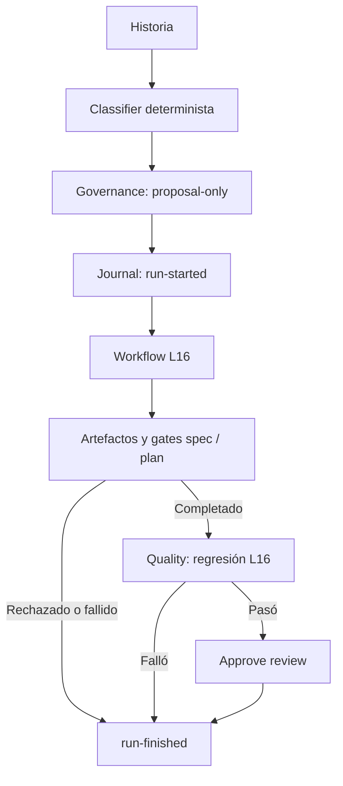

# Módulo 4 · Lección 1 — Governance, Human Approval Gates, auditoría y evidencia

**Lección global:** 17/20 · **Nivel:** avanzado · **Complejidad:** muy alta · **Duración:** 180–240 min.

**Proyecto:** Agent Harness Lab v0.16.0 → v0.17.0. Base: snapshot de la lección 16; `main` remoto consultado en v0.16.0. Los archivos de workflow coinciden con el snapshot. No reemplazar archivos propios. Este laboratorio no es un sistema de auditoría de producción.

## 1. Objetivos y prerrequisitos

- Comprender la diferencia entre políticas, autorización, aprobaciones de etapas, controles de herramientas y pruebas.
- Vincular las decisiones a un artefacto exacto y a una ejecución.
- Persistir evidencia verificable e identificar sus límites de confianza.
- Separar el resultado del agente de una comprobación ejecutada por el host.
- Experimentar sin tokens mediante simulación.

Prerrequisitos: L9 (interceptores), L14 (RPC), L15 (contexto), L16 (workflows). Node >=22.19, npm y TypeScript; Pi autenticado sólo para `live`. Leer primero `src/workflow.ts` y `src/workflow-cli.ts` de L16.

## 2. Governance no es un prompt

Un prompt como «no realices cambios sin autorización» es una instrucción al modelo, no un control de acceso. La autorización debe ser decidida por código confiable fuera de las decisiones del modelo. Separar:

| Control | Pregunta | Ejemplo |
|---|---|---|
| Política | ¿Qué puede hacer el sistema? | No declarar herramientas de escritura |
| Aprobación de etapa | ¿Puede continuar el proceso? | Aprobar la especificación exacta |
| Aprobación de herramienta | ¿Se permite esta llamada puntual? | Confirmar `edit` cuando el guard está cargado |
| Quality gate | ¿Existe una verificación ejecutada que satisface una condición? | Resultado de un proceso de tests |
| Auditoría | ¿Qué ocurrió, cuándo y con qué restricción? | Evento y digest de artefacto |

Aprobar un plan no autoriza automáticamente sus acciones. Una lectura no es equivalente a una escritura. Una revisión textual del LLM no equivale a un test automatizado. El operador tampoco puede hacer que una prueba fallida pase por aprobarla.

## 3. Fronteras de confianza

El operador confiable configura y ejecuta el host. La historia, la memoria recuperada y las respuestas del modelo son datos; no otorgan capacidades. Las funciones de ejecución y verificación inyectadas son código de confianza del host, no funciones que el LLM pueda suministrar. No ejecutar el laboratorio desde un checkout desconocido: los tests son código de ese checkout y se ejecutan con permisos del usuario. Pi, las herramientas y extensiones tampoco son un sandbox.

El perfil de L17 es `proposal-only`. El modo gobernado admite `simulate` o `live` por RPC sin herramientas. Los adaptadores CLI, SDK y RPC directos conservan su comportamiento: la política no se ha impuesto globalmente. El antiguo guard se refuerza para impedir `write`/`edit` sobre `.lab-evidence` cuando está cargado; no bloquea toda lectura ni sustituye una frontera OS. No cargar extensiones no confiables.

## 4. Arquitectura y flujo



Las rutas existentes no cambian. En modo gobernado todas añaden un control de calidad y aprobación final si las etapas anteriores terminan correctamente. El journal se abre antes de las etapas de ejecución; la validación CLI y el arranque RPC/get_state son preflight fuera del journal. En este perfil se rechaza `--llm-classify` hasta auditar esa etapa; la clasificación determinista y escalamiento por operador siguen disponibles.

| Ruta | Etapas y gates | Control final agregado |
|---|---|---|
| simple | propose → review | calidad → approve-review |
| medium | plan → approve-plan → propose → review | calidad → approve-review |
| complex | specify → approve-spec → plan → approve-plan → propose → review | calidad → approve-review |

El resultado exterior `status` decide el exit code (0 completado, 2 rechazado, 1 error/fallo). `workflow.status` corresponde al flujo textual interno; puede ser completed mientras el resultado exterior es failed/rejected por el control final. Ninguno significa que la historia esté implementada.

## 5. Política de ejecución — `src/governance.ts`

```ts
export const POLICY = Object.freeze({
  version: 1,
  profile: 'proposal-only',
  tools: Object.freeze([] as string[]),
  extensions: false,
  mcp: false,
  finalReview: true,
  quality: 'workflow-regression'
});
```

El digest de la política se calcula mediante SHA-256 de su serialización JSON. No se acepta un archivo generado por el modelo que cambie esta decisión. `validateExecution()` comprueba un perfil sin herramientas y el runtime admisible; el CLI utiliza `LabRpcClient.start` con `readOnly:false`, que **significa sin herramientas** en el contrato previo de L14, no acceso de escritura. Comprueba `buildRpcArgs` para ver los flags `--no-tools`, `--no-session`, `--no-mcp`, `--no-extensions`, `--no-skills`, `--no-context-files` y `--no-prompt-templates`. No se hereda el allowlist de herramientas de los perfiles CLI. El resultado de cada prompt RPC comprueba que no aparezcan llamadas a herramientas; esa detección es defensiva, no aislamiento del sistema operativo.

`--operator` en live es obligatorio y sólo registra una etiqueta declarada. No es autenticación, RBAC ni identidad certificada. Simulate registra la fuente `simulation` aun cuando su decisión es approve. No se admite `--decision` en live. En live sólo se solicita la decisión en una TTY y una respuesta distinta de `APROBAR` deniega. No hay operador disponible → no autorizar.

## 6. Aprobar contenido, no intenciones abstractas

```ts
interface ApprovalRequest {
  requestId: string;
  runId: string;
  gate: string;
  artifactStage: string;
  digest: string;
  policyHash: string;
}
interface ApprovalReceipt {
  requestId: string;
  digest: string;
  decision: 'approve' | 'deny';
}
```

El host calcula el SHA-256 del texto exacto (UTF-8); no pide al modelo calcularlo. El callback recibe copias del contenido y la solicitud. El operador ve el artefacto y su digest, y el host emite un recibo asociado. `approvalAccepted()` comprueba las tres propiedades, los valores exactos y `approve`. Un recibo anterior no autoriza una nueva solicitud aunque el contenido sea igual. Si la decisión no coincide o no llega, no se avanza. En una cancelación se registra `cancelled` cuando es posible. La decisión persiste antes de devolver el resultado al motor; una falla de escritura impide certificar el éxito. El recibo es un contrato local, no una firma de identidad ni un token portable de autorización.

### Experimento sin LLM

```ts
const req = approvalRequest('demo', 'approve-plan', 'plan', 'Añadir E2E');
const receipt = { requestId:req.requestId, digest:req.digest, decision:'approve' };
approvalAccepted(req, receipt); // true
const changed = approvalRequest('demo', 'approve-plan', 'plan', 'Omitir E2E');
approvalAccepted(changed, receipt); // false
```

Aunque el texto no cambiara, un nuevo ID invalida el recibo anterior. Para procesos distribuidos, hace falta un servicio autenticado que vincule run ID, actor, permisos, alcance, vigencia y nonce de uso único, con persistencia transaccional.

## 7. Evidence Journal — `src/evidence.ts`

Cada ejecución recibe un UUID generado por el host. En `.lab-evidence/<runId>/` se escribe `events.jsonl` y archivos de texto por etapa (`specify`, `plan`, `propose`, `review` cuando corresponda). Se usa creación exclusiva para los artefactos y el diario, y escritura append con flush. Hay un único escritor por ejecución. El directorio se ignora en Git; se solicitan permisos 0700 y 0600 en sistemas compatibles, en Windows revisar ACL reales. Se rechazan symlinks iniciales y rutas no válidas en lectura. No protege contra carreras de FS, reemplazos concurrentes por otros procesos o un atacante con los mismos permisos.

Eventos principales:

| Evento | Datos |
|---|---|
| run-started | UUID, modo, etiqueta, story ID/digest, política/digest |
| stage-started | ID de etapa |
| artifact | etapa, tamaño, digest del texto persistido |
| approval-requested | ID de solicitud, gate, hash, política, run ID |
| approval-decided | solicitud, gate, digest, decisión y fuente |
| workflow-result | estado, clasificación final, pasos y referencias de contexto |
| quality-started | nombre del control |
| quality-result | resultado, código de salida, tiempo, digest de salida, alcance |
| governance-failed | motivo genérico |
| run-finished | estado exterior y resultado de controles |

No guardamos prompts completos ni errores internos, pero los artefactos textuales pueden contener información sensible. Los hashes de información de baja entropía tampoco anonimizan. Usar datos sintéticos. Límite de artefacto 6000 bytes, diario 256 KiB. No hay cifrado, retención, límite global de disco, ni rotación automática. Configurar esas capacidades antes de uso corporativo.

## 8. Encadenamiento y verificación

Por cada evento se genera `body={seq,at,type,data,previous}`. Se serializa mediante JSON y se calcula `hash=sha256(JSON.stringify(body))`. El primer `previous` es una cadena de 64 ceros. El registro completo es `{...body,hash}`. El siguiente evento usa el hash anterior. JSONL separa registros por LF; los saltos de línea del texto JSON se escapan.

`verifyEvidence(cwd, runId)` verifica el formato y secuencia, digest de la política conocida, hash de cada registro, referencias y digest/tamaño de artefactos, correlación de solicitudes y decisiones, cierre y presencia de controles requeridos para un resultado completado. No es un verificador formal de todas las transiciones posibles. No dice que una persona realmente firmó ni que un test realmente ocurrió si el host mintió. Sólo verifica consistencia del registro local. Una evidencia `failed` o `rejected` puede estar íntegra; ausencia de cierre no se certifica. Si el diario no se puede escribir, no se certifica un flujo válido. No hay reanudación ni reparación automática de ejecuciones interrumpidas.

Quien puede modificar toda la cadena puede recalcular hashes. Un ancla externa confiable, firma, almacenamiento de sólo escritura o servicio separado puede reforzar integridad. La versión base no incorpora ese servicio; US-LAB-017 muestra la comparación con un hash externo. No confundir hash con HMAC, cifrado, firma ni no repudio.

## 9. Quality Gate — `src/governed-workflow.ts`

```ts
const r = spawnSync(process.execPath, ['--test', testFile], {
  cwd: root, shell: false, timeout: 20000,
  maxBuffer: 1024 * 1024, windowsHide: true
});
```

El control fijo ejecuta `tests/workflow.test.mjs` del propio laboratorio ya compilado. El nombre del test, ejecutable y parámetros son definidos por el host, no por el LLM ni la historia. Es un smoke/regression gate verdadero para L16, **no verifica que se haya implementado la propuesta**. Se ejecuta inclusive en simulate aprobado; los textos y aprobaciones son simulados, pero el proceso de tests es real. Exit code cero y ausencia de error → passed. Timeout, salida excesiva, error o código distinto de cero → failed. No se persisten stdout/stderr crudos; se calcula un hash de su representación base64 en JSON. Ese hash no permite reproducir/verificar la salida ausente sin conservarla externamente. El tiempo se mide con performance.now. `spawnSync` bloquea el hilo durante un máximo configurado (el OS puede demorar el cierre); se elige sencillez para este control acotado, no es un executor de producción para procesos arbitrarios; tampoco garantiza terminar todos sus descendientes. Ejecutar únicamente un checkout confiable.

El review textual no acredita tests. En producción: suite seleccionada por política del repositorio, ejecución aislada, resultados estructurados (JUnit/Playwright), identidad del commit, diff, entorno, versión, logs protegidos, y gate independiente. Las pruebas E2E de frontend deben ser realmente ejecutadas y reportadas cuando se implementa esa integración. L18 incorpora SDD, no fingimos evidencia de OpenSpec hoy.

## 10. Composición sin reimplementar el motor

`runGovernedWorkflow()` invoca `runWorkflow()` de L16 con dependencias decoradas: `execute` registra inicio y artefacto antes de entregar resultado; `approve` prepara solicitud, captura recibo y persiste decisión. Luego verifica status interior y ejecuta calidad/aprobación final. El motor anterior permanece intacto. El modelo no obtiene el handle del journal. `workflow-cli.ts` añade `--governed` optativo; no crea una segunda CLI general ni un segundo Agent Loop.

La política común a todo el ciclo de vida es una meta: los modos CLI/SDK directos y RPC directo están fuera de este perfil. La ruta siguiente es hacer cumplir autorización en el boundary de herramientas y capacidades, con credenciales mínimas, gates por cambios y evidencia de tests funcionales, no extender flags sin controles.

## 11. Laboratorio guiado

Compilar y ejecutar desde la raíz del repo confiable:

```sh
npm install
npm test
npm run typecheck
npm run workflow:run -- --story examples/workflows/medium.json --mode simulate --governed --decision approve
```

Ver `runId`, `status`, `workflow.steps`, `quality` y `finalReview`. Copiar el runId para verificar:

```sh
npm run evidence:verify -- RUN_ID_REAL
```

La salida incluye `runId`, `records`, `head`, `status`, `mode`. Revisar el diario local, no subirlo a Git. `head` es útil para el ejercicio.

Rechazo temprano:

```sh
npm run workflow:run -- --story examples/workflows/complex.json --mode simulate --governed --decision deny
```

Esperar exit code 2, `rejected`, calidad `null`, pasos posteriores `skipped`. Verificar también este journal.

Simulación de alteración: copiar el directorio de un run de ejemplo a otro workspace dentro de `.lab-evidence`, modificar un artefacto y ejecutar el verificador en dicha copia. Debe fallar; no modificar evidencia real.

Live opcional, sólo datos ficticios y operador presente:

```sh
npm run workflow:run -- --story examples/workflows/medium.json --mode live --governed --operator operator-demo
```

Pi debe estar autenticado. La entrada `APROBAR` continúa cada gate; toda otra respuesta rechaza. Hay propuestas textuales, no escritura de archivos de producto ni comandos del modelo. El host sí escribe la evidencia local y corre la regresión predefinida. No ejecutar `--llm-classify` con `--governed` en esta versión. Los ejemplos funcionan sin sintaxis específica de Bash; en PowerShell escribirlos en una línea.

## 12. Pruebas y troubleshooting

`tests/governance.test.mjs`: política, etiqueta, recibos incompatibles, rutas, calidad, rechazo, cancelación, errores, journal, alteraciones, fs, CLI offline, guard. Los callbacks unitarios usan resultados de pruebas simuladas; dos casos ejecutan la suite real del laboratorio. Los tests RPC anteriores usan un proceso simulado; no se contacta a modelos. Si falla el guard por una ruta protegida, no relajar la política para ocultarlo. Si no hay diálogo live por una ejecución en CI, rechazar y usar simulación para la práctica. Si falla evidencia, revisar permisos y espacio; no editar manualmente el journal para convertir un fallo en éxito. Si falla quality por timeout, revisar el entorno y suite; no sustituir el resultado por texto del modelo.

## 13. Ejercicio US-LAB-017 — Ancla externa de integridad

Implementar `verifyAnchoredEvidence(cwd, runId, expectedHead)`. Añadir `--expected-head` al CLI de evidencia. El ancla se obtiene de un canal externo de confianza y se pasa como SHA-256 hexadecimal; **no leerlo desde el mismo diario**. Comparar sólo después de verificar evidencia. Rechazar hash incorrecto, mal formado o evidencia alterada. Mantener función anterior y modo sin ancla. No afirmar que el ancla autentica al operador.

Criterios: (1) hash válido de 64 hex minúsculos, (2) verifica primero el diario y los artefactos, (3) compara el head, (4) conserva compatibilidad, (5) test que recalcula toda la cadena tras cambiar un registro y demuestra rechazo por el ancla. La solución incluye tres tests y un ejemplo de recálculo controlado. Copiar archivos de `solutions/modulo-04-leccion-01/src/` y `tests/` a los directorios correspondientes sólo al finalizar el ejercicio. Leer el README de solución. Ejecutar `npm test` y `npm run typecheck`. Para comprobar desde terminal: `npm run evidence:verify -- RUN_ID_REAL --expected-head HASH_CONFIABLE`. No usar el hash de un registro ya manipulado como ancla.

## 14. Preguntas de repaso

1. ¿Qué diferencia hay entre aprobar un plan y una llamada a `write`?
2. ¿Puede un operador aprobar un test fallido para obtener status completed en este perfil? No; el quality gate antecede al gate final.
3. ¿Un diario íntegro implica que los datos son verdaderos? No; garantiza consistencia respecto de la cadena, no verdad ni autoría.
4. ¿Por qué el modo simulate puede tener calidad real? Ejecuta código de test del laboratorio; la simulación comprende el modelo y las decisiones, no ese proceso.
5. ¿Qué ocurre si el diario deja de escribirse? Se corta la ejecución gobernada y no se emite cierre exitoso verificable.
6. ¿Cómo mejorar una integración corporativa? Identidad SSO, permisos mínimos, políticas versionadas fuera del repo del agente, auditoría remota, almacenamiento con retención y DLP, tests aislados, evidencia ligada a un commit y firma/ancla, y no permitir cambios autónomos hasta controlar todos los adaptadores.

## 15. Archivos, resultados y límites

Nuevos: `src/governance.ts`, `src/evidence.ts`, `src/governed-workflow.ts`, `src/evidence-cli.ts`, `tests/governance.test.mjs`, `examples/governance/README.md`, solución separada. Modificados: `src/workflow-cli.ts`, `.gitignore`, `.pi/policies/approval-policy.mjs`, package.json y documentación. `src/runtime.ts`, `src/cli.ts`, `src/rpc-client.ts`, `src/sdk-runner.ts`, `src/workflow.ts` permanecen intactos en el snapshot. El patch preserva archivos del usuario que no modifica. Snapshot completo de curso, no clon remoto; excluye memoria local, dependencias, dist, evidencias y lockfile propio del usuario. Actualizar lockfile mediante npm install en el repositorio real. No se hicieron commits remotos.

Validación local: 227 tests previos pasaron; 251 total (24 nuevos), 1 omitido por plataforma, 0 fallos; 254 con solución, 1 omitido. Node 22.16 y TypeScript 5.8.3 disponibles, con tipos Node locales; se declara mínimo Node 22.19. No se ejecutó Pi autenticado ni tests nativos Windows en este entorno. Los nuevos tests incluyen el proceso real de regresión, no cambios reales de producto. El checkout remoto completo no se clonó; se contrastaron archivos relevantes. El patch se prueba contra copia limpia del snapshot. No hay aprobación autenticada, no hay sandbox, no hay DLP, no hay verificación externa de logs, no hay escrituras del agente ni merge/deploy. Las pruebas no convierten el lab en un producto certificado.

## 16. Referencias y próximo paso

- Pi RPC: https://github.com/earendil-works/pi/blob/main/packages/coding-agent/docs/rpc.md
- Pi RPC commands: https://github.com/earendil-works/pi/blob/main/packages/coding-agent/docs/rpc-commands.md
- Pi extensions: https://pi.dev/docs/latest/extensions
- OWASP Logging Cheat Sheet: https://cheatsheetseries.owasp.org/cheatsheets/Logging_Cheat_Sheet.html
- Node crypto: https://nodejs.org/api/crypto.html
- Node child_process: https://nodejs.org/api/child_process.html

Progreso: 17 de 20 lecciones (85%). Siguiente: Módulo 4 · Lección 2 (global 18), SDD e integración con OpenSpec. Queremos que la especificación y los cambios aprobados estén vinculados a evidencia real, sin convertir cada corrección simple en un proceso burocrático.
